# Term Project Report — Secure Build

> Team report for **NoteVault** (`project/starter-app/`), following `REPORT-TEMPLATE.md`.
> Each member's raw working notes and evidence live under [`report/`](report/) (see Appendix A).
>
> `<!-- TODO -->` marks the few items only the team can fill in (student IDs, video link).

## Cover

| Field | Value |
|---|---|
| Team name | Jikko |
| Members (name + ID) | Supawan Kongsapcharoen — 6631503042 · Phuriphat Chantiuaong — 6631503034 · Danaiphong Songsikhwa — 6631503106 · Sadayu Suriya — 6631503040 |
| Target application | NoteVault (`project/starter-app/`) |
| Repository URL | https://github.com/ninacodin/software-security-Jikko |
| Date | 2026-10-30 |

## AI-tool usage disclosure

| Member | Tool | How it was used |
|---|---|---|
| Supawan | Claude Code | Reviewed the three injection fixes (F-01–F-03), **verified them by running** the before/after exploits in Docker, and drafted the threat model (DFD + STRIDE) and the injection finding & remediation write-ups. All tool output was run and checked by the member, who can explain each payload and fix. |
| Phuriphat | Claude Code | Reviewed the code, implemented and tested the auth/session/crypto fixes (F-04 – F-08), drafted the first report skeleton. All fixes reviewed and run by the member. |
| Danaiphong | Codex | Reviewed the access-control code, proposed patches and the regression test suite, drafted notes. The member checked the results and explains the fixes in their own words. |
| Sadayu | Claude Code | Helped run Trivy / pip-audit / Cosign, write the Dockerfile and CI workflow, and merge the four members' sections into this report. All tool output in `report/person-d/evidence/` comes from real runs. |

---

## 1. Executive Summary

NoteVault is a small Flask web app and JSON API. Users register, log in (JWT in a cookie), create
and search their own notes, and export them; an admin can list all users. It worked end-to-end
but had never been security-reviewed.

The team split the review into four workstreams — **A** injection & input, **B** authentication,
session & crypto, **C** access control & output, **D** supply chain & build/CI — and found
**15 vulnerabilities**:

| Severity | Count | Findings |
|---|---|---|
| Critical | 3 | F-03 OS command injection → RCE as root · F-04 hard-coded signing key → forge admin token · F-15 insecure container (root, baked secret) |
| High | 7 | F-01 SQLi auth bypass · F-02 SQLi credential dump · F-06 unsalted MD5 · F-09 self-assigned admin role · F-10 IDOR · F-12 XSS / SSTI · F-14 vulnerable dependencies |
| Medium | 4 | F-07 cookie flags · F-08 tokens never expire · F-11 admin leaks hashes · F-13 debug mode |
| Low | 1 | F-05 `alg:none` left in JWT allowlist (not exploitable as shipped) |

**Before:** an unauthenticated attacker could log in as admin with `admin'-- -` (F-01), register
themselves as admin (F-09), or forge an admin token with the key from the source (F-04); any
logged-in user could run shell commands **as root** in the container (F-03 + F-15) and read
every user's notes and password hashes (F-02, F-10).

**After:** all 15 findings are fixed on the merged branch. Every fix has a commit, and the
exploits were re-run and now fail (§5). On the integrated code all security gates are clean:
Trivy **0** HIGH/CRITICAL (deps + Dockerfile + secrets), Semgrep **0** blocking findings (was 11),
Gitleaks **0** leaks, pip-audit **0** known vulnerabilities, and Danaiphong's 17 regression tests
pass. The CI gate fails the build on any HIGH/CRITICAL finding (§7).

---

## 2. System Scope & Function

**Components and endpoints**

| Component | Detail |
|---|---|
| Web/API process (P1) | Flask `app.py`, all routes below |
| Export subprocess (P2) | OS command spawned by `/export` |
| Database (D1) | SQLite at `/tmp/notevault.db` — `users(id, username, password, role)`, `notes(id, owner, title, body)` |
| Session token | JWT (HS256) signed with a server secret, stored client-side in the `session` cookie |

| Endpoint | Auth | Purpose |
|---|---|---|
| `/` | optional | home; lists the logged-in user's notes |
| `POST /register` | none | create account |
| `POST /login` | none | issue session JWT cookie |
| `/logout` | — | clear cookie |
| `POST /notes` | user | create note |
| `/api/notes/<id>` | user | fetch one note (JSON) |
| `/search?q=` | user | search own notes |
| `/admin` | admin | list all users |
| `/export?fmt=` | user | "export" convenience |

**Data-Flow Diagram**

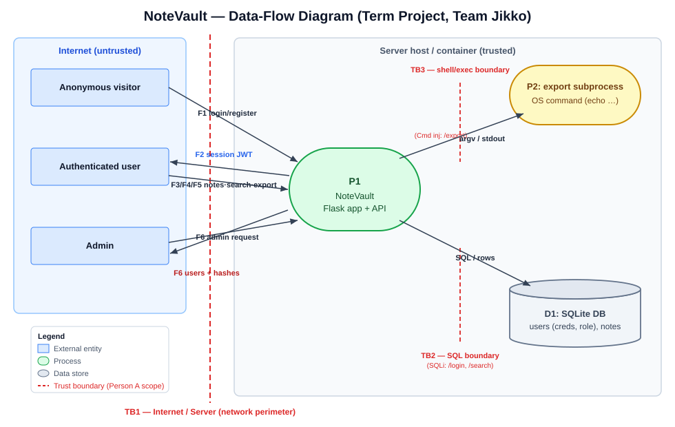

Trust boundaries:
- **TB1 — Internet ↔ App.** Every HTTP request crosses it; all input is untrusted.
- **TB2 — App ↔ SQLite.** Untrusted input becomes SQL → SQL-injection surface (`/login`, `/search`).
- **TB3 — App ↔ OS shell.** Untrusted input becomes a command → command-injection surface (`/export`).
- **TB4 — Client ↔ Server session trust.** The server trusts a JWT it signed; a weak or leaked key lets a client forge identity.
- **TB5 — Build/supply chain ↔ Runtime.** Third-party packages and the base image run inside the container with the app's privileges.

---

## 3. Threat Model — STRIDE  *(20 pts)*

✔ = a realistic threat exists in the original code.

| Element / data flow | S | T | R | I | D | E | Top threat & mitigation |
|---|:--:|:--:|:--:|:--:|:--:|:--:|---|
| **TB1** HTTP request → P1 | ✔ | ✔ | ✔ | ✔ | ✔ | ✔ | Untrusted input is the root of most findings. Validate/encode at the boundary; authn + authz per route. |
| **TB2** login creds → SQL | ✔ | ✔ | | | | ✔ | SQLi auth bypass (F-01). *Parameterized query.* |
| **TB2** search `q` → SQL | | ✔ | | ✔ | | | SQLi `UNION` dumps password hashes (F-02). *Parameterized + escaped `LIKE`.* |
| **TB3** export `fmt` → shell | | ✔ | | ✔ | ✔ | ✔ | Command injection → RCE as root (F-03). *Allowlist + `shell=False`.* |
| **TB4** session JWT | ✔ | ✔ | ✔ | | | ✔ | Hard-coded key → forged admin token (F-04); `none` alg (F-05); no expiry (F-08). *Key from env, HS256 only, `exp`.* |
| Session cookie | ✔ | | ✔ | ✔ | | | No `HttpOnly`/`Secure`/`SameSite` → theft, CSRF (F-07). *Set all three flags.* |
| **D1** stored passwords | | | | ✔ | | | Unsalted MD5 → instant cracking (F-06). *bcrypt.* |
| `/register` role field | ✔ | | | | | ✔ | Client sets `role=admin`; duplicate username takes over account (F-09). *Server-assigned role, `UNIQUE`.* |
| `/api/notes/<id>` | | | | ✔ | | ✔ | IDOR reads any note (F-10). *Owner check in the query.* |
| `/admin` response | | | | ✔ | | | Returns every password hash (F-11). *Select only needed columns.* |
| Note body rendered | | ✔ | | ✔ | | ✔ | Stored XSS + SSTI (F-12). *Fixed templates, autoescape.* |
| P1 `debug=True` | | ✔ | | ✔ | | ✔ | Werkzeug debugger / stack traces (F-13). *Debug off.* |
| **TB5** dependencies | | ✔ | | ✔ | ✔ | ✔ | Known-vulnerable Flask/Werkzeug/Jinja2/PyJWT (F-14). *Patched pins + SCA gate.* |
| **TB5** container image | | ✔ | | ✔ | | ✔ | Runs as root, secret in a layer, mutable base (F-15). *Non-root, digest pin, no `ENV` secret.* |

### Top 5 risks (likelihood × impact)

| # | Risk | Finding | Likelihood | Impact | Rating |
|---|---|---|---|---|---|
| 1 | Command injection at `/export` → RCE as **root** | F-03 (+ F-15) | High | Critical | **Critical** |
| 2 | Hard-coded signing key → forge any user's session | F-04 | High | Critical | **Critical** |
| 3 | SQLi at `/login` → authentication bypass | F-01 | High | High | **High** |
| 4 | `/register` role injection → become admin | F-09 | High | High | **High** |
| 5 | SQLi at `/search` → dump all credential hashes | F-02 (+ F-06) | High | High | **High** |

Risks chain across workstreams: F-03 is worse because of F-15 (the shell runs as root), and
F-02 / F-11 are worse because of F-06 (the leaked hashes are unsalted MD5).

---

## 4. Vulnerability Findings  *(25 pts)*

OWASP categories use the **Top 10:2025** numbering. "Owner" is the member who found and fixed it.

### Finding F-01 — SQL injection at `/login` (authentication bypass) · *owner: Supawan*
| Field | Value |
|---|---|
| CWE | CWE-89 |
| OWASP 2025 | A05:2025 Injection |
| Severity | **High** |
| Location | `app.py` `/login` |
| Reproduction | `POST /login` `username=admin'-- -` `password=wrong` — `-- -` comments out the password check. |
| Impact | Log in as any user, including `admin`, without a password. |
| Evidence | `302` + `Set-Cookie: session=…` — [screenshot](report/person-a/screenshots/1-before-login.png) |

### Finding F-02 — SQL injection at `/search` (credential dump via UNION) · *owner: Supawan*
| Field | Value |
|---|---|
| CWE | CWE-89 |
| OWASP 2025 | A05:2025 Injection |
| Severity | **High** |
| Location | `app.py` `/search` |
| Reproduction | `GET /search?q=%' UNION SELECT id,username,password FROM users-- -` |
| Impact | Every username and password hash is returned on the page. |
| Evidence | `alice: 15da1f78…`, `admin: 0192023a…` — [screenshot](report/person-a/screenshots/2-before-search.png) |

### Finding F-03 — OS command injection at `/export` (RCE as root) · *owner: Supawan*
| Field | Value |
|---|---|
| CWE | CWE-78 |
| OWASP 2025 | A05:2025 Injection |
| Severity | **Critical** |
| Location | `app.py` `/export` — `subprocess.run("echo exporting notes as " + fmt, shell=True)` |
| Reproduction | `GET /export?fmt=txt;id` |
| Impact | Arbitrary command execution as `uid=0(root)` in the container. |
| Evidence | output contains `uid=0(root) gid=0(root)` — [screenshot](report/person-a/screenshots/3-before-export.png) |

### Finding F-04 — Hard-coded session-signing key · *owner: Phuriphat*
| Field | Value |
|---|---|
| CWE | CWE-798 |
| OWASP 2025 | A07:2025 Authentication Failures |
| Severity | **Critical** |
| Location | `app.py` `SECRET = "notevault-dev-secret"`; also `Dockerfile` `ENV APP_SECRET=…` (see F-15) |
| Reproduction | Sign `{"sub":"admin"}` with HS256 and `notevault-dev-secret`, send it as the `session` cookie. |
| Impact | Anyone with the repo or image can impersonate any user, including admin; the key cannot be rotated. |
| Evidence | Baseline `/admin` → `HTTP 200` with the forged token (verified by running). |

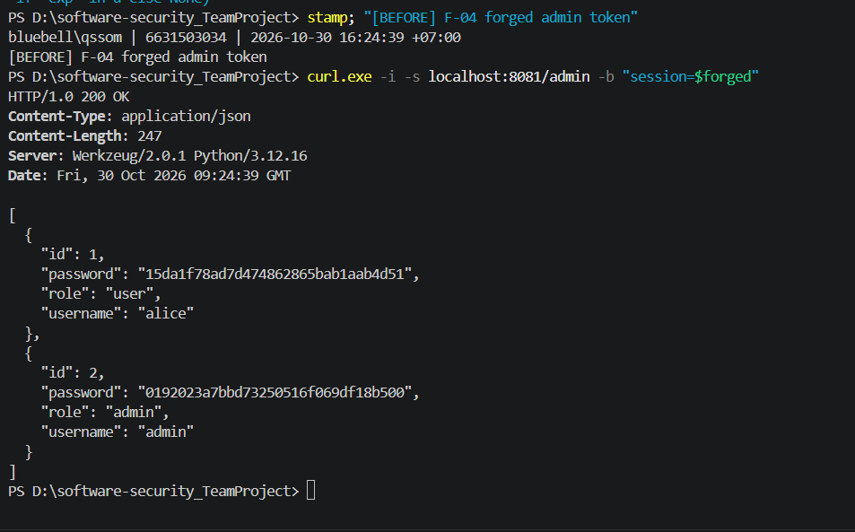

### Finding F-05 — `alg:none` left in the JWT allowlist · *owner: Phuriphat*
| Field | Value |
|---|---|
| CWE | CWE-347 |
| OWASP 2025 | A07:2025 Authentication Failures |
| Severity | Low |
| Location | `app.py` `current_user()` — `algorithms=["HS256", "none"]` |
| Reproduction | Sent an unsigned `{"alg":"none"}` / `{"sub":"admin"}` token → **rejected** (`HTTP 403`): PyJWT 1.7.1 raises `InvalidKeyError` because a key is supplied. |
| Impact | Not exploitable as shipped, but becomes an auth bypass if the key is ever empty or the library changes. Removed as defence-in-depth. |

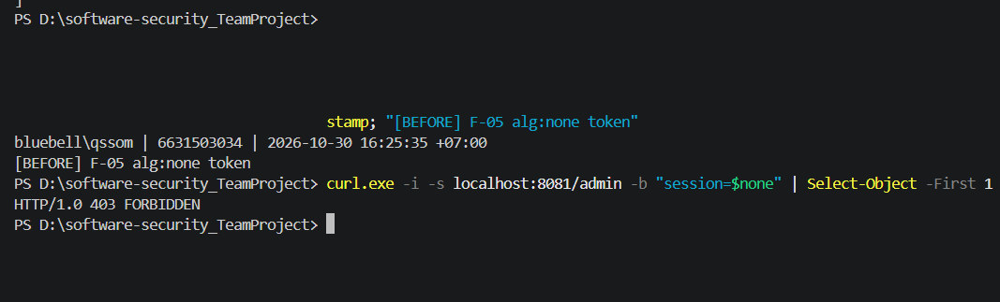

### Finding F-06 — Passwords hashed with unsalted MD5 · *owner: Phuriphat*
| Field | Value |
|---|---|
| CWE | CWE-327 / CWE-916 |
| OWASP 2025 | A04:2025 Cryptographic Failures |
| Severity | **High** |
| Location | `app.py` `seed()`, `/register`, `/login` — `hashlib.md5(pw).hexdigest()` |
| Reproduction | Take the hashes leaked by F-02 or F-11 and crack them offline (`hashcat -m 0`); equal passwords share a hash. |
| Impact | Mass credential disclosure on any database or response leak. |

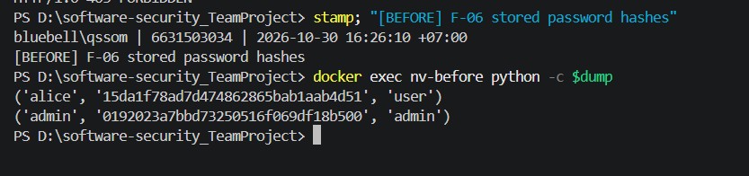

### Finding F-07 — Session cookie without security flags · *owner: Phuriphat*
| Field | Value |
|---|---|
| CWE | CWE-614 / CWE-1004 |
| OWASP 2025 | A02:2025 Security Misconfiguration |
| Severity | Medium |
| Location | `app.py` `/login` — `resp.set_cookie("session", tok)` |
| Reproduction | `Set-Cookie` has no `HttpOnly`, `Secure` or `SameSite`. |
| Impact | Cookie readable by injected JS, sent over plain HTTP, no CSRF defence. |

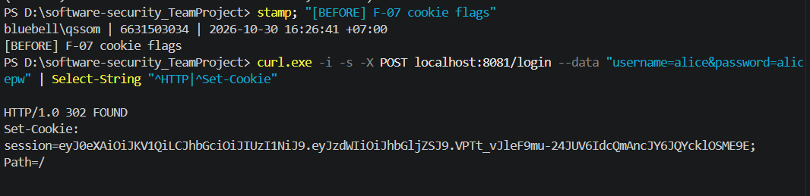

### Finding F-08 — Session tokens never expire · *owner: Phuriphat*
| Field | Value |
|---|---|
| CWE | CWE-613 |
| OWASP 2025 | A07:2025 Authentication Failures |
| Severity | Medium |
| Location | `app.py` `/login` — `jwt.encode({"sub": username}, …)` |
| Reproduction | Decode the token: no `exp` claim. |
| Impact | A stolen token works forever. |

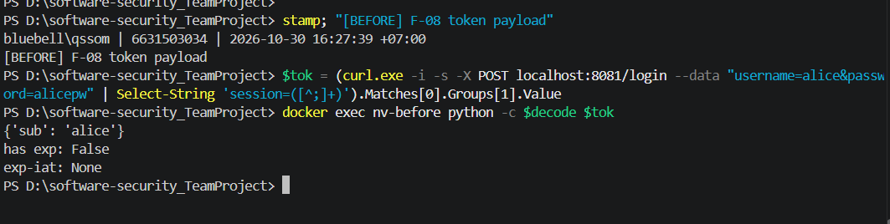

### Finding F-09 — Self-assigned admin role and duplicate-username takeover · *owner: Danaiphong*
| Field | Value |
|---|---|
| CWE | CWE-269 (more specifically CWE-266) |
| OWASP 2025 | A01:2025 Broken Access Control |
| Severity | **High** |
| Location | `app.py` `register()`; `users` schema in `seed()` |
| Reproduction | `POST /register` with `username=c-review&password=testpw&role=admin`, log in, open `/admin` → allowed. Second path: register `admin` again with a new password; the JWT subject is `admin` and `role_of()` returns the original admin's role. |
| Impact | Anyone can become admin without logging in. |
| Evidence | Regression tests — [test results](report/person-c/test-results.txt) (baseline fails, fix passes). |

### Finding F-10 — IDOR / BOLA on `/api/notes/<id>` · *owner: Danaiphong*
| Field | Value |
|---|---|
| CWE | CWE-639 |
| OWASP 2025 | A01:2025 Broken Access Control (API1:2023 BOLA) |
| Severity | **High** |
| Location | `app.py` `api_note()` — selects by `id` only |
| Reproduction | Log in as `alice`, request `/api/notes/2` → admin's note (`prod db password is hunter2`). |
| Impact | Any user reads any note by enumerating IDs. |

### Finding F-11 — `/admin` returns password hashes · *owner: Danaiphong*
| Field | Value |
|---|---|
| CWE | CWE-200 |
| OWASP 2025 | A01:2025 Broken Access Control |
| Severity | Medium |
| Location | `app.py` `admin()` — `SELECT id,username,password,role` |
| Reproduction | As admin (or via F-09), `GET /admin` → JSON includes every `password` hash. |
| Impact | Credential material exposed for no functional reason; chains with F-06. |

### Finding F-12 — Stored XSS and server-side template injection · *owner: Danaiphong*
| Field | Value |
|---|---|
| CWE | CWE-79; CWE-1336 (SSTI) |
| OWASP 2025 | A05:2025 Injection |
| Severity | **High** (SSTI runs on the server; XSS alone would be Medium) |
| Location | `PAGE` `{{ notes_html\|safe }}`, `search()` concatenating note text into the template source, `export()` HTML output |
| Reproduction | Save a note with body `` → rendered unescaped. Save `{{7*7}}` and search for it → page shows `49`. |
| Impact | Script in the victim's browser; template expressions evaluated on the server. |

### Finding F-13 — Flask debug mode enabled · *owner: Danaiphong*
| Field | Value |
|---|---|
| CWE | CWE-489 |
| OWASP 2025 | A02:2025 Security Misconfiguration |
| Severity | Medium |
| Location | `app.py` `app.run(..., debug=True)` |
| Reproduction | Any unhandled exception shows the Werkzeug debugger and stack trace. |
| Impact | Information disclosure; debugger console access if the PIN is obtained. |

### Finding F-14 — Known-vulnerable dependencies · *owner: Sadayu*
| Field | Value |
|---|---|
| CWE | CWE-1395 (also CWE-1104) |
| OWASP 2025 | A03:2025 Software Supply Chain Failures |
| Severity | **High** |
| Location | `requirements.txt` — Flask 2.0.1, Werkzeug 2.0.1, Jinja2 3.0.1, PyJWT 1.7.1, requests 2.25.1, urllib3 1.26.4 |
| Reproduction | `trivy fs --scanners vuln --severity HIGH,CRITICAL project/starter-app`; `pip-audit -r requirements.txt` |
| Impact | Trivy: **16 HIGH/CRITICAL CVEs** (15 HIGH, 1 CRITICAL); pip-audit: **80 advisories in 7 packages** — incl. PyJWT forged-token, Jinja2 sandbox escape, Werkzeug debugger/DoS issues. |
| Evidence | [trivy-fs.txt](report/person-d/evidence/before/trivy-fs.txt), [pip-audit.txt](report/person-d/evidence/before/pip-audit.txt) |

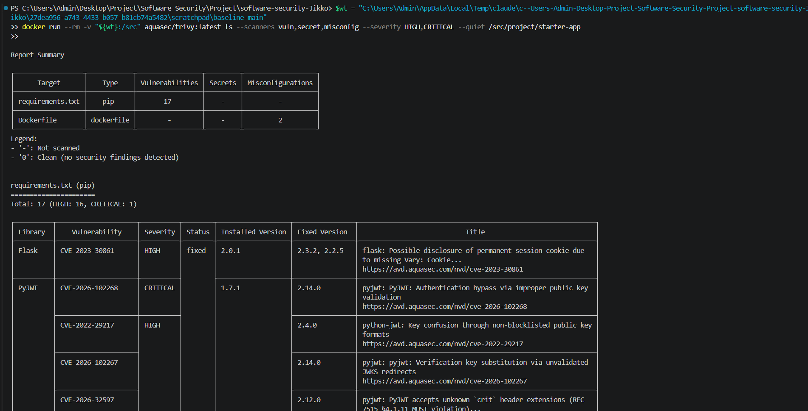

### Finding F-15 — Insecure container build · *owner: Sadayu*
| Field | Value |
|---|---|
| CWE | CWE-250 (root), CWE-798 (secret baked in image), CWE-1104 (unpinned base) |
| OWASP 2025 | A02:2025 Security Misconfiguration |
| Severity | **Critical** (baked secret) / High (root) |
| Location | `Dockerfile` — `FROM python:3.12`, `ENV APP_SECRET=notevault-dev-secret`, `COPY . .`, no `USER` |
| Reproduction | `trivy fs --scanners misconfig project/starter-app` → `DS-0002` (HIGH, root), `DS-0031` (CRITICAL, secret in `ENV`). |
| Impact | Any code-exec bug (F-03) runs as root; the signing key ships in an image layer; the base image can change under the build. |
| Evidence | [screenshot](report/person-d/evidence/ci/fig-trivy-before-3-dockerfile.png) |

---

## 5. Remediation  *(25 pts)*

Every fix is a separate commit. All of them are merged into `main`; the combined code is
`project/starter-app/app.py`.

### Fix for F-01 — parameterized login query · commit `d66e777` (Supawan)
```diff
- q = "SELECT * FROM users WHERE username = '%s' AND password = '%s'" % (username, md5(...))
- row = con.execute(q).fetchone()
+ q = "SELECT * FROM users WHERE username = ? AND password = ?"
+ row = con.execute(q, (username, pw_hash)).fetchone()
```
- **Why:** input is bound as data and never parsed as SQL. *(Later replaced by Phuriphat's bcrypt lookup, F-06, which keeps the parameterized query.)*
- **Proof:** `username=admin'-- -` → `401 login failed`.

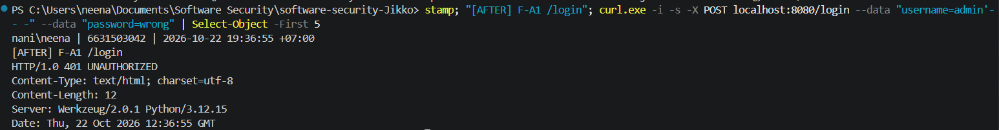

### Fix for F-02 — parameterized search with escaped `LIKE` · commit `d66e777` (Supawan)
```diff
- q = "SELECT id,title,body FROM notes WHERE owner='%s' AND body LIKE '%%%s%%'" % (user, term)
+ like = term.replace("\\", "\\\\").replace("%", "\\%").replace("_", "\\_")
+ q = "SELECT id,title,body FROM notes WHERE owner = ? AND body LIKE ? ESCAPE '\\'"
+ rows = con.execute(q, (user, "%" + like + "%")).fetchall()
```
- **Why:** the term cannot break out of the string; `%`, `_` and `\` match literally.
- **Proof:** the UNION payload returns an empty list.

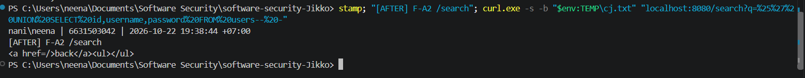

### Fix for F-03 — allowlist + no shell · commit `d66e777` (Supawan)
```diff
- out = subprocess.run("echo exporting notes as " + fmt, shell=True, ...)
+ if fmt not in {"txt", "csv", "json"}:
+     return "invalid format", 400
+ out = subprocess.run(["echo", "exporting notes as", fmt], shell=False, ...)
```
- **Why:** two independent layers — unknown formats are rejected, and no shell ever parses the value.
- **Proof:** `fmt=txt;id` → `400 invalid format`; `fmt=csv` still works. With F-15 fixed, the process is no longer root anyway.

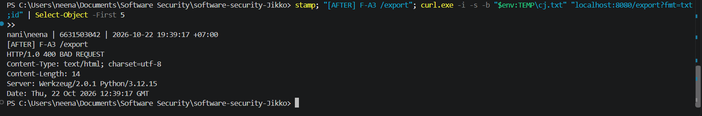

### Fix for F-04 — signing key from the environment · commit `caff106` (Phuriphat)
```diff
- SECRET = "notevault-dev-secret"
+ SECRET = os.environ["APP_SECRET"]
```
```diff
# docker-compose.yml
+ - APP_SECRET=${APP_SECRET:?set APP_SECRET in your shell before starting}
```
- **Why:** the key leaves the source and the image, is injected at runtime and can be rotated. The app fails closed if it is missing.
- **Proof:** the token forged with the old key → `HTTP 403`; `docker compose up` without `APP_SECRET` aborts.
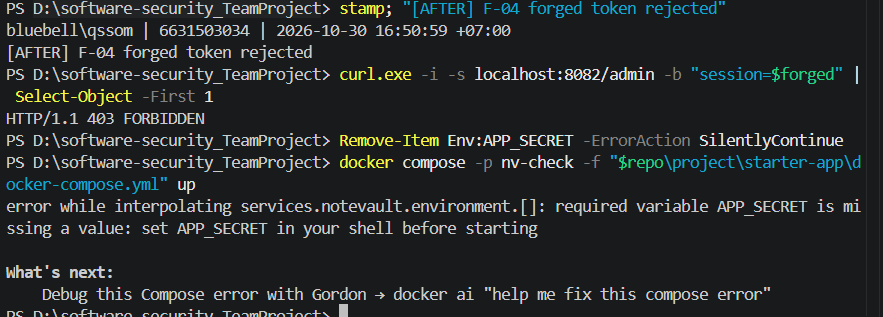


### Fix for F-05 — HS256 only · commit `47b12b6` (Phuriphat)
```diff
- data = jwt.decode(tok, SECRET, algorithms=["HS256", "none"])
+ data = jwt.decode(tok, SECRET, algorithms=["HS256"])
```
- **Proof:** `alg:none` token → `HTTP 403`; `none` is no longer an accepted algorithm.
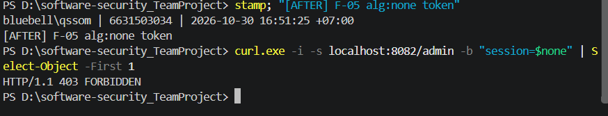

### Fix for F-06 — bcrypt · commit `29a125e` (Phuriphat)
```diff
- (username, hashlib.md5(password.encode()).hexdigest(), role)
+ (username, hash_pw(password), role)          # bcrypt.hashpw(..., bcrypt.gensalt())
- row = con.execute("... username='%s' AND password='%s'" % ...).fetchone()
+ row = con.execute("SELECT * FROM users WHERE username = ?", (username,)).fetchone()
+ if not row or not verify_pw(password, row["password"]):
```
- **Why:** per-hash salt and adaptive cost; `bcrypt.checkpw` compares in constant time. Adds `bcrypt==4.2.1`.
- **Proof:** DB rows store `$2b$12$…`; correct password → `302`, wrong → `401`.
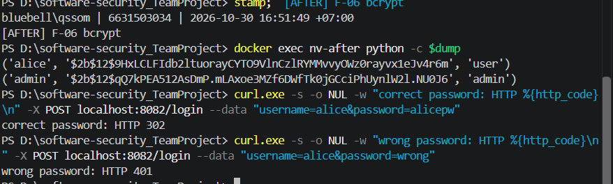

### Fix for F-07 — cookie flags · commit `b576f57` (Phuriphat)
```diff
- resp.set_cookie("session", tok)
+ resp.set_cookie("session", tok, httponly=True, secure=True, samesite="Lax")
```
- **Proof:** `Set-Cookie: session=…; Secure; HttpOnly; Path=/; SameSite=Lax`.
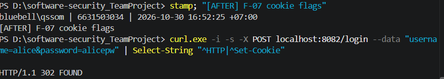
### Fix for F-08 — token expiry · commit `59132fa` (Phuriphat)
```diff
- tok = jwt.encode({"sub": username}, SECRET, algorithm="HS256")
+ now = datetime.now(timezone.utc)
+ tok = jwt.encode({"sub": username, "iat": now, "exp": now + timedelta(hours=1)}, SECRET, algorithm="HS256")
```
- **Proof:** decoded payload has `exp − iat = 3600`; `jwt.decode()` rejects expired tokens.
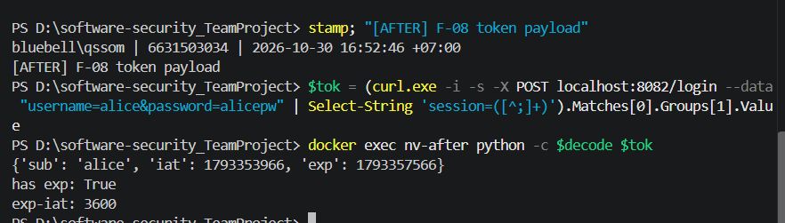
### Fix for F-09 — server-assigned role, unique usernames · commit `574af26` (Danaiphong)
```diff
- role = request.form.get("role") or (request.json or {}).get("role") or "user"
+ # Public registration cannot grant a privileged role.
+ ... (username, hash_pw(password), "user")
- username TEXT, password TEXT, role TEXT
+ username TEXT NOT NULL UNIQUE, password TEXT NOT NULL, role TEXT NOT NULL
```
- **Why:** the client can no longer choose its role, and the DB rejects a second `admin`. Invalid input → `400`, duplicate → `409`.
- **Proof:** `role=admin` registration → regular user, `/admin` → `403`; re-registering `admin` → `409`.

### Fix for F-10 — owner check · commit `2c5df1b` (Danaiphong)
```diff
- r = con.execute("SELECT id,owner,title,body FROM notes WHERE id = ?", (nid,)).fetchone()
+ r = con.execute("SELECT id,owner,title,body FROM notes WHERE id = ? AND owner = ?", (nid, user)).fetchone()
```
- **Proof:** alice → `/api/notes/1` `200`; `/api/notes/2` and a missing ID both → identical `404`.

### Fix for F-11 — no hashes in `/admin` · commit `1e605be` (Danaiphong)
```diff
- rows = con.execute("SELECT id,username,password,role FROM users").fetchall()
+ rows = con.execute("SELECT id,username,role FROM users").fetchall()
```
- **Proof:** response objects contain only `id`, `username`, `role`.

### Fix for F-12 — fixed templates with autoescape · commit `80cf57a` (Danaiphong)
```diff
- <h3>Your notes</h3>{{ notes_html|safe }}
+ <li>#{{ note.id }} <b>{{ note.title }}</b>: {{ note.body }}</li>
- render_template_string("<a href=/>back</a><ul>" + HTML_FROM_NOTE_VALUES + "</ul>")
+ render_template_string(SEARCH_PAGE, notes=rows)
- return "<pre>%s</pre>" % out.stdout
+ return render_template_string("<pre>{{ output }}</pre>", output=out.stdout)
```
- **Why:** user data is passed to Jinja as values, never as template source, so it is escaped and never evaluated.
- **Proof:** `<script>`/`` come back as `&lt;…&gt;`; `{{7*7}}` stays literal.

### Fix for F-13 — debug off · commit `af24b72` (Danaiphong)
```diff
- app.run(host="0.0.0.0", port=8080, debug=True)
+ app.run(host="0.0.0.0", port=8080, debug=False, use_debugger=False, use_reloader=False)
```
- **Proof:** test confirms all three are off even with `FLASK_DEBUG=1`.

### Fix for F-14 — patched, fully pinned dependencies · commit `c8a2c7d` (Sadayu)
```diff
- Flask==2.0.1        + Flask==3.1.3
- Werkzeug==2.0.1     + Werkzeug==3.1.9
- Jinja2==3.0.1       + Jinja2==3.1.6
- PyJWT==1.7.1        + PyJWT==2.15.1
- requests==2.25.1    (removed — not imported)
- urllib3==1.26.4     (removed — not imported)
                      + MarkupSafe, itsdangerous, click, blinker pinned (transitive)
```
- **Why:** every flagged package moves to a patched release; unused packages are removed, not patched.
- **Note:** merging the auth branch re-added `requests==2.25.1` / `urllib3==1.26.4`; this was caught during integration and removed again (keeping `bcrypt`).
- **Proof:** Trivy → **0**; pip-audit on the final integrated `requirements.txt` → *"No known vulnerabilities found"* ([integrated/pip-audit.txt](report/person-d/evidence/integrated/pip-audit.txt)).

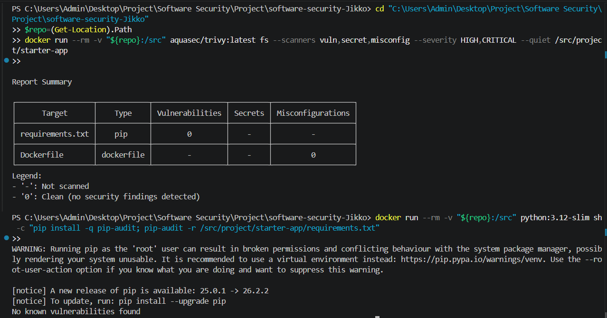

### Fix for F-15 — hardened Dockerfile · commit `86655f9` (Sadayu)
```diff
- FROM python:3.12
- ENV APP_SECRET=notevault-dev-secret
- COPY . .
- RUN pip install -r requirements.txt
+ FROM python:3.12-slim@sha256:a6e34c598f2467ed0e9a8d349809fcd8b5c603269512df273a0bb1784edc11b1
+ COPY requirements.txt .
+ RUN pip install --no-cache-dir -r requirements.txt
+ COPY app.py .
+ RUN useradd --create-home --uid 10001 appuser
+ USER appuser
```
- **Why:** immutable base (digest), no secret in any layer, non-root user, and an allowlist `.dockerignore` (only `app.py`, `requirements.txt`).
- **Proof:** Trivy misconfig → **0**; `docker compose exec notevault whoami` → `appuser`.

### Integrated check (all four branches merged)

Every check below was re-run on the combined code, with the same settings as CI:

| Check | Baseline | Integrated code | Evidence |
|---|---|---|---|
| Trivy — deps + Dockerfile + secrets (HIGH/CRITICAL) | 16 CVEs + 2 misconfigs | **0** | [trivy-fs.txt](report/person-d/evidence/integrated/trivy-fs.txt) |
| pip-audit | 80 advisories | **0** | [pip-audit.txt](report/person-d/evidence/integrated/pip-audit.txt) |
| Semgrep `p/default` + `p/owasp-top-ten` (blocking) | 11 | **0** (6 files scanned) | [semgrep.txt](report/person-d/evidence/integrated/semgrep.txt) |
| Gitleaks | 0 | **0** | [gitleaks.txt](report/person-d/evidence/integrated/gitleaks.txt) |
| Regression tests (Danaiphong's suite) | fail (`failures=18, errors=13`) | **17/17 pass** | [unittest.txt](report/person-d/evidence/integrated/unittest.txt) |

---

## 6. Supply-Chain Hardening  *(15 pts)*

- **SBOM:** [`sbom.json`](report/person-d/sbom/sbom.json) — CycloneDX 1.7, **97 components**,
  generated from the built image: `trivy image --format cyclonedx -o sbom.json starter-app-notevault:latest`.
- **Signing:** the image is signed by digest with Cosign, and the SBOM is attached as a signed
  CycloneDX attestation. Public key: [`cosign.pub`](report/person-d/cosign/cosign.pub); the private key is not committed.
  ```
  $ cosign verify --key cosign.pub localhost:5000/notevault@sha256:068f72af…
  Verification for localhost:5000/notevault@sha256:068f72af… --
    - The cosign claims were validated
    - Existence of the claims in the transparency log was verified offline
    - The signatures were verified against the specified public key
  ```
  Full output: [verify-output.txt](report/person-d/cosign/verify-output.txt), [verify-attestation.txt](report/person-d/cosign/verify-attestation.txt).
- **Other controls:** base image pinned by digest; all Python packages pinned including transitive
  ones; GitHub Actions pinned to commit SHAs; Dependabot config in `.github/dependabot.yml`.
- **SLSA self-assessment — Build L1, with a clear path to L2.** The source is version-controlled,
  the build is scripted (Dockerfile), and it produces a signed artifact plus a signed SBOM
  attestation, so provenance exists and can be verified — that meets L1. We are **not** at L2,
  which needs provenance generated and signed by a hosted build service rather than on a
  developer laptop. Next step: move build + sign into GitHub Actions with keyless (OIDC) Cosign
  so the CI platform attests the provenance.

---

## 7. Security CI Pipeline  *(10 pts)*

- **Workflow:** [`.github/workflows/project-security.yml`](../.github/workflows/project-security.yml),
  runs on every push/PR that touches `project/starter-app/**`. Three gates:

  | Gate | Tool | Fails the build when |
  |---|---|---|
  | SAST | Semgrep `p/default` + `p/owasp-top-ten` | any ERROR-severity finding (`--error`) |
  | SCA + misconfig + secrets | Trivy fs | any HIGH/CRITICAL (`exit-code: 1`) |
  | Secrets | Gitleaks v8.24.3 (`dir`, app folder only) | any secret found (`--exit-code 1`) |

- **Proof the gate fails on HIGH/CRITICAL:**
  - Baseline — Trivy **fails**: https://github.com/ninacodin/software-security-Jikko/actions/runs/39839508883
  - After Sadayu's fixes — Trivy **passes**: https://github.com/ninacodin/software-security-Jikko/actions/runs/39839516007
  - After all fixes are merged, the same three gates run locally all pass (Trivy 0, Semgrep 0 of 11, Gitleaks 0 — see §5 "Integrated check").

  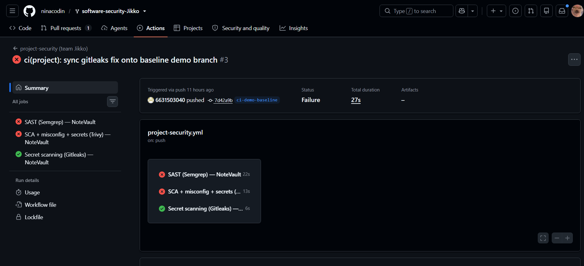
  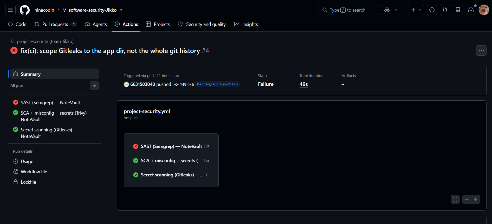

- **Configuration notes**
  - The repo-root `.semgrepignore` excludes `project/starter-app/`, so the Semgrep job copies the
    app out of the repo before scanning; scanning in place reports "0 targets" — a false pass.
  - Gitleaks' default rules do not detect the low-entropy `notevault-dev-secret`; Trivy's
    misconfig check `DS-0031` does. Gitleaks stays for real credential formats.
  - Gitleaks originally scanned the whole git history and flagged a sample PEM key quoted in a CVE
    description inside our own evidence file; it was scoped to the app folder (commit `149f636`).

---

## 8. Conclusion & Reflection  *(5 pts — clarity)*

**Residual risks / what we would harden next**
- **No CSRF tokens.** `SameSite=Lax` blocks most cross-site POSTs, but explicit CSRF tokens on state-changing forms would close it fully.
- **No rate limiting** on `/login` and `/register` — online password guessing is still possible.
- **No session revocation.** Logout only clears the cookie; a stolen token stays valid until `exp` (1 h).
- **Development server.** `app.run()` is Flask's dev server; production should use gunicorn behind a TLS proxy (needed for the `Secure` cookie flag to work).
- **`/export` still spawns a process.** It is safe now, but building the output in Python would remove the subprocess entirely.
- **SLSA L2** — move build + signing into CI with keyless Cosign (§6).
- **Existing databases.** The `UNIQUE` username constraint only applies to newly seeded databases; a real deployment needs a migration.

**Lessons learned**
- **Vulnerabilities chain across owners.** Command injection (Supawan) became root RCE because of the container (Sadayu); SQLi (Supawan) and the admin leak (Danaiphong) mattered more because of MD5 (Phuriphat). Splitting work by area was efficient, but the threat model had to be done together.
- **Verify, don't assume.** The classic `alg:none` bypass did *not* work on PyJWT 1.7.1; the real forgery path was the hard-coded key. Running the exploit changed the severity.
- **Merges can quietly undo fixes.** Integrating the auth branch re-added two vulnerable packages that D had removed. Re-running SCA and tests on the merged code — not just per branch — caught it.
- **Scanner config can give false passes.** An ignore file made Semgrep scan zero files while showing green. A passing gate is only evidence if you know what it scanned.

---

## Appendix

### A. Task split and per-member material

| Member | Workstream | Findings | Working notes & evidence |
|---|---|---|---|
| Supawan Kongsapcharoen | Injection & input; DFD + threat model | F-01 – F-03 | [`report/person-a/`](report/person-a/) |
| Phuriphat Chantiuaong | Auth, session & crypto; first report draft | F-04 – F-08 | [`report/person-b/`](report/person-b/) |
| Danaiphong Songsikhwa (Bas) | Access control & output; regression tests | F-09 – F-13 | [`report/person-c/`](report/person-c/), [`tests/test_person_c.py`](tests/test_person_c.py) |
| Sadayu Suriya | Supply chain, Docker, SBOM/Cosign, CI; report assembly & demo | F-14 – F-15 | [`report/person-d/`](report/person-d/) |

### B. Finding ID cross-reference

| Report ID | Supawan | Phuriphat | Danaiphong | Sadayu |
|---|---|---|---|---|
| F-01 / F-02 / F-03 | F-A1 / F-A2 / F-A3 | | | |
| F-04 / F-05 / F-06 / F-07 / F-08 | | B2 / B1 / B3 / B4 / B5 | | |
| F-09 / F-10 / F-11 / F-12 / F-13 | | | F-C01 / F-C02 / F-C03 / F-C04 / F-C05 | |
| F-14 / F-15 | | | | F-D1 / F-D2 |

### C. Demo video

- Video: `<!-- TODO: link -->`
- Script: [`report/person-d/demo-script.md`](report/person-d/demo-script.md)

### D. Tools

Trivy, pip-audit, Semgrep, Gitleaks, Cosign, Docker / Docker Compose, Python `unittest`, GitHub Actions, curl.

### E. References

- OWASP Top 10:2025 — https://owasp.org/Top10/2025/
- OWASP API Security Top 10:2023 — https://owasp.org/API-Security/
- MITRE CWE — https://cwe.mitre.org/ (CWE-78, 79, 89, 200, 250, 266, 269, 327, 347, 489, 613, 614, 639, 798, 916, 1004, 1104, 1336, 1395)
- SLSA v1.0 — https://slsa.dev/spec/v1.0/levels
- Sigstore Cosign — https://docs.sigstore.dev/
- CycloneDX — https://cyclonedx.org/

---

## Grading rubric (100)

| Criterion | Pts |
|---|---|
| Threat model quality & completeness (§3) | 20 |
| Vulnerability findings — correctness, CWE/OWASP mapping, depth (§4) | 25 |
| Remediation quality — correct, minimal, well-explained (§5) | 25 |
| Supply-chain hardening — SBOM + signing + provenance (§6) | 15 |
| CI pipeline — works, fails build appropriately (§7) | 10 |
| Presentation & report clarity (§1, §8) | 5 |
