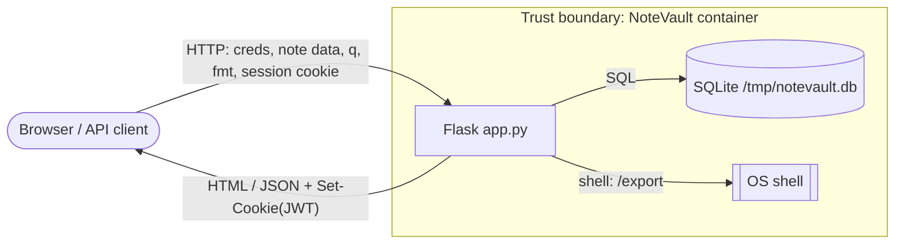

# Term Project Report — Secure Build

> Team report assembled per `REPORT-TEMPLATE.md`. Total **100 pts**.
> **Assembly owner:** คน B — keeps §1 (Executive Summary) and §4 (Findings) in sync.
>
> **Status key:** ✅ done & verified-by-run · ✍️ drafted from code review, **owner must verify/remediate** · `<!-- TODO -->` not started.
> Findings B1–B5 (auth/session/crypto) are fixed and tested. Everything marked ✍️ was
> documented by the assembly owner from the source so the report is complete, but the
> **named owner is responsible** for confirming reproduction, writing the fix, and signing
> off their own section (per the peer-contribution rules).

## Cover

| Field | Value |
|---|---|
| Team name | `<!-- TODO -->` |
| Members (name + ID) | `<!-- TODO -->` |
| Target application | NoteVault (`project/starter-app/`) |
| Repository URL | https://github.com/<team>/software-security-Jikko (fork of nutthakorn7/software-security) |
| Date | 2026-10-20 |

## AI-tool usage disclosure

| Tool | How it was used |
|---|---|
| Claude Code (Opus 4.8) | Reviewed the code, implemented & tested the auth/session/crypto fixes (B1–B5) on `remediation/auth-session-crypto`, and assembled this report (§1–§5 structure, finding write-ups). All fixes reviewed and run by the team. |
| `<!-- TODO: teammates add their own tools -->` | |

---

## 1. Executive Summary

NoteVault is a small Flask web app + JSON API: users register / log in (cookie session),
create and search their own notes, and there is an admin user list and an "export" endpoint.
It works end-to-end but was built without a security review.

A review across the course's vulnerability classes found **13 issues** spanning input
handling, access control, sessions & cryptography, dependencies, and container/build config.

**Findings by severity:**

| Severity | Count | Examples |
|---|---|---|
| Critical | 2 | Hard-coded signing key → forge valid admin token (B2); OS command injection in `/export` (I3) |
| High | 5 | Unsalted MD5 passwords (B3); SQL injection in `/search` (I1); IDOR in `/api/notes` (A1); Flask `debug=True` (C1); vulnerable dependencies (S1) |
| Medium | 5 | Cookie without security flags (B4); tokens never expire (B5); stored XSS in `/search` (I2); admin endpoint leaks password hashes (A2); container runs as root / unpinned base (C2) |
| Low | 1 | `alg:none` left in the JWT allowlist (B1) — footgun, not exploitable under PyJWT 1.7.1 |

**Overall risk — before:** an attacker who read the repo/image could forge a valid admin
session token (B2) — **verified**: a token signed with the leaked key returned `/admin`
`HTTP 200` — or run shell commands on the server (I3) for full compromise; stored
credentials were trivially crackable (B3). **After (auth/session/crypto workstream
complete):** session tokens are signed with a runtime-injected key, restricted to `HS256`,
time-limited and carried in a hardened cookie; passwords use bcrypt. The remaining
input-handling, access-control, supply-chain and container fixes are tracked in §5–§7 by
their owners.

> **Reproduction note (integrity):** every B-finding was *run* against both the vulnerable
> baseline and the fix. The commonly-assumed `alg:none` bypass (B1) **does not work here** —
> PyJWT 1.7.1 refuses a `none` token when a key is supplied (`InvalidKeyError`), so B1 is a
> latent footgun (Low); the real token-forgery path is the hard-coded key (B2).

---

## 2. System Scope & Function

**Components / endpoints:**

| Endpoint | Auth | Purpose |
|---|---|---|
| `/` | optional | home; lists the logged-in user's notes |
| `/register` `POST` | none | create account |
| `/login` `POST` | none | issue session JWT cookie |
| `/logout` | — | clear cookie |
| `/notes` `POST` | user | create note |
| `/api/notes/<id>` | user | fetch one note (JSON) |
| `/search?q=` | user | search own notes |
| `/admin` | admin | list all users |
| `/export?fmt=` | user | "export" convenience |

- **Session:** signed JWT in the `session` cookie; `current_user()` decodes it per request.
- **Data store:** SQLite at `/tmp/notevault.db`, tables `users(id,username,password,role)` and `notes(id,owner,title,body)`.

**Data-Flow Diagram (trust boundary = the Flask process / container edge):**


`<!-- threat-model owner: replace with the official DFD image if required -->`

---

## 3. Threat Model — STRIDE  *(20 pts)*  ✍️ *(owner: threat-model lead — review & extend)*

| Element / data flow | S | T | R | I | D | E | Top threat & mitigation |
|---|---|---|---|---|---|---|---|
| Client → `/login` (credentials) | ✔ | | | ✔ | | ✔ | **S/E:** forged/`alg:none` token or stolen hash → impersonation. *Mitigate:* HS256-only, bcrypt, secret from env (B1–B3). |
| Session cookie (JWT) | ✔ | ✔ | | ✔ | | ✔ | **I/T:** cookie theft via XSS/network, no expiry. *Mitigate:* HttpOnly+Secure+SameSite, `exp` (B4–B5). |
| Client → `/search?q` → SQLite | | ✔ | | ✔ | | ✔ | **T/I:** SQL injection dumps other users' / admin data. *Mitigate:* parameterized query (I1). |
| `/search` response (note body) | | ✔ | | ✔ | | | **T:** stored XSS executes in victim browser. *Mitigate:* auto-escape / no `render_template_string` on user data (I2). |
| Client → `/export?fmt` → OS shell | | ✔ | | ✔ | ✔ | ✔ | **E/D:** command injection → RCE. *Mitigate:* drop shell, whitelist fmt (I3). |
| `/api/notes/<id>` → SQLite | | | | ✔ | | ✔ | **I/E:** IDOR reads any note. *Mitigate:* owner check (A1). |
| Container / build | | ✔ | | ✔ | | ✔ | **E:** root container, baked secret, debug console. *Mitigate:* non-root, no ENV secret, `debug=False` (B2, C1, C2). |

*Top 5 risks by likelihood × impact:* I3 (RCE) · B2 (token forgery via leaked key) · I1 (SQLi) · A1 (IDOR) · B3 (credential disclosure).

---

## 4. Vulnerability Findings  *(25 pts)*

> IDs grouped by workstream: **B**=auth/session/crypto (done), **I**=input handling,
> **A**=access control, **C**=config/container, **S**=supply chain. Assembly owner renumbers
> to F-01… for the final submission.

### ✅ B1 — `alg:none` left in the JWT algorithm allowlist (latent footgun)
| Field | Value |
|---|---|
| CWE / OWASP | CWE-347 · A07 Identification & Authentication Failures |
| Severity | **Low** (not exploitable as shipped — see note) |
| Location | `app.py` `current_user()` — `jwt.decode(..., algorithms=["HS256", "none"])` |
| Reproduction attempted | Sent `session=eyJ0eXAiOiJKV1QiLCJhbGciOiJub25lIn0.eyJzdWIiOiJhZG1pbiJ9.` (`{"alg":"none"}`/`{"sub":"admin"}`). **Result: rejected** — on both baseline and fix `/admin` → `HTTP 403`. PyJWT 1.7.1 raises `InvalidKeyError: When alg = "none", key value must be None` because a (non-empty) key is passed, so the classic bypass fails here. |
| Impact | None as shipped, but accepting `none` is a known auth-bypass pattern: it would become exploitable if the key were ever empty or the JWT library changed. Removed as defence-in-depth. |

### ✅ B2 — Hard-coded session-signing key (verified token forgery)
| Field | Value |
|---|---|
| CWE / OWASP | CWE-798 · A07 |
| Severity | **Critical** |
| Location | `app.py` `SECRET = "notevault-dev-secret"` + `Dockerfile` `ENV APP_SECRET=...` |
| Reproduction | The key is in the source and baked into the image. Sign a valid `HS256` token `{"sub":"admin"}` with `notevault-dev-secret` and send it as the `session` cookie. **Verified:** baseline `/admin` → `HTTP 200` (authenticated as admin); against the fix (random runtime key) the same token → `HTTP 403`. |
| Impact | Full authentication bypass / admin impersonation for anyone with the repo or image; the key cannot be rotated. **This is the real critical auth-bypass, not B1.** |

### ✅ B3 — Passwords hashed with unsalted MD5
| Field | Value |
|---|---|
| CWE / OWASP | CWE-327 / CWE-916 · A02 Cryptographic Failures |
| Severity | **High** |
| Location | `app.py` seed, `/register`, `/login` — `hashlib.md5(pw).hexdigest()` |
| Reproduction | Dump `users` and crack MD5 instantly (`hashcat -m 0`); identical passwords share a hash. |
| Impact | Mass credential disclosure on any DB leak. |

### ✅ B4 — Session cookie without security flags
| Field | Value |
|---|---|
| CWE / OWASP | CWE-614 · A05 Security Misconfiguration |
| Severity | Medium |
| Location | `app.py` `/login` — `resp.set_cookie("session", tok)` |
| Reproduction | `Set-Cookie` carries no `HttpOnly`/`Secure`/`SameSite`; JS can read it, it rides plain HTTP, no CSRF defence. |
| Impact | Session theft via XSS / network; CSRF exposure. |

### ✅ B5 — Session tokens never expire
| Field | Value |
|---|---|
| CWE / OWASP | CWE-613 · A07 |
| Severity | Medium |
| Location | `app.py` `/login` — `jwt.encode({"sub": username}, ...)` (no `exp`) |
| Reproduction | Token has no `exp`, so a captured token is valid forever; no revocation. |
| Impact | A stolen/leaked token grants permanent access. |

### ✍️ I1 — SQL injection in `/search`  *(owner: input handling)*
| Field | Value |
|---|---|
| CWE / OWASP | CWE-89 · A03 Injection |
| Severity | **High** |
| Location | `app.py:178` (main) — `"...WHERE owner='%s' AND body LIKE '%%%s%%'" % (user, term)` |
| Reproduction | `q` is concatenated into SQL. Craft `q` to break out of the `LIKE` clause / `UNION SELECT username,password,role FROM users` to read other users' and admin's data. *(owner: add exact payload + sqlmap output)* |
| Impact | Read/exfiltrate arbitrary DB rows, including password hashes. |

### ✍️ I2 — Stored/reflected XSS in `/search`  *(owner: input handling)*
| Field | Value |
|---|---|
| CWE / OWASP | CWE-79 · A03 Injection |
| Severity | Medium |
| Location | `app.py:181` (main) — results built with `render_template_string("..." + raw title/body)` |
| Reproduction | Save a note whose body contains `<script>…</script>`, then search; the body is rendered unescaped and executes. *(owner: add payload + screenshot)* |
| Impact | Script execution in victim's session (cookie theft, actions as user). |

### ✍️ I3 — OS command injection in `/export`  *(owner: input handling)*
| Field | Value |
|---|---|
| CWE / OWASP | CWE-78 · A03 Injection |
| Severity | **Critical** |
| Location | `app.py:202` (main) — `subprocess.run("echo exporting notes as " + fmt, shell=True, ...)` |
| Reproduction | `/export?fmt=txt;id` (or `$(...)`) runs arbitrary shell commands with `shell=True`. *(owner: add payload + command output)* |
| Impact | Remote code execution on the server → full compromise. |

### ✍️ A1 — IDOR in `/api/notes/<id>`  *(owner: access control)*
| Field | Value |
|---|---|
| CWE / OWASP | CWE-639 · A01 Broken Access Control |
| Severity | **High** |
| Location | `app.py` `api_note()` — fetches note by `id` with **no owner check** |
| Reproduction | Log in as `alice`, request `/api/notes/2` (admin's note) → returns a note the user doesn't own (e.g. the admin "infra" note). *(owner: add request/response)* |
| Impact | Any user reads any note by enumerating IDs. |

### ✍️ A2 — Admin endpoint exposes password hashes  *(owner: access control)*
| Field | Value |
|---|---|
| CWE / OWASP | CWE-200 / CWE-522 · A01 / A02 |
| Severity | Medium |
| Location | `app.py:191` (main) — `SELECT id,username,password,role FROM users` returned to client |
| Reproduction | `/admin` returns every user's `password` hash in the JSON. *(owner: add response)* |
| Impact | Credential-hash disclosure (compounded weak hashing — see B3). |

### ✍️ C1 — Flask debug mode enabled  *(owner: config/container)*
| Field | Value |
|---|---|
| CWE / OWASP | CWE-489 / CWE-215 · A05 Security Misconfiguration |
| Severity | **High** |
| Location | `app.py:209` (main) — `app.run(..., debug=True)` |
| Reproduction | An unhandled exception shows the Werkzeug interactive debugger / stack traces; the console can allow code execution. *(owner: trigger an error + screenshot)* |
| Impact | Information disclosure and potential RCE via the debugger. |

### ✍️ C2 — Container runs as root on an unpinned base  *(owner: config/container)*
| Field | Value |
|---|---|
| CWE / OWASP | CWE-250 / CWE-1104 · A05 |
| Severity | Medium |
| Location | `Dockerfile` — `FROM python:3.12` (no digest pin), no `USER`, secret baked (see B2) |
| Reproduction | `docker exec … whoami` → `root`; base tag is mutable. *(owner: add output)* |
| Impact | Larger blast radius on container escape; non-reproducible builds. |

### ✍️ S1 — Known-vulnerable dependencies  *(owner: supply chain)*
| Field | Value |
|---|---|
| CWE / OWASP | CWE-1395 · A06 Vulnerable & Outdated Components |
| Severity | **High** |
| Location | `requirements.txt` — Flask 2.0.1, Werkzeug 2.0.1, Jinja2 3.0.1, PyJWT 1.7.1, requests 2.25.1, urllib3 1.26.4 |
| Reproduction | Run Trivy / `pip-audit` on the image → CVEs in these pinned versions. *(owner: paste scan output + CVE IDs)* |
| Impact | Exploitable known CVEs in the running stack. |

---

## 5. Remediation  *(25 pts)*

### Auth / session / crypto — ✅ implemented on `remediation/auth-session-crypto`

#### B1 — restrict JWT algorithms · commit `47b12b6`
```diff
- data = jwt.decode(tok, SECRET, algorithms=["HS256", "none"])
+ data = jwt.decode(tok, SECRET, algorithms=["HS256"])
```
- **Why:** removes the `none` footgun so the code can never be coerced into skipping signature checks (defence-in-depth; see B1's note on why it was not exploitable as shipped).
- **Proof (verified):** forged `alg:none` admin token → `/admin` `HTTP 403` on both baseline and fix (PyJWT 1.7.1 already rejected it); after the fix `none` is not even an accepted algorithm.

#### B2 — key from env, not baked in · commit `caff106`
```diff
- SECRET = "notevault-dev-secret"
+ SECRET = os.environ["APP_SECRET"]
```
```diff
# Dockerfile:  - ENV APP_SECRET=notevault-dev-secret
# compose:     + - APP_SECRET=${APP_SECRET:?set APP_SECRET in your shell before starting}
```
- **Why:** the key leaves the source/image, is injected at runtime, and can be rotated; app fails closed if unset.
- **Proof (verified):** a token `{"sub":"admin"}` signed with the leaked `notevault-dev-secret` → baseline `/admin` `HTTP 200`, fixed `/admin` `HTTP 403` (fix uses a random runtime key). Also, with `APP_SECRET` unset, `docker compose up` aborts — *"required variable APP_SECRET is missing a value"*.

#### B3 — bcrypt instead of MD5 · commit `29a125e`
```diff
- (username, hashlib.md5(password.encode()).hexdigest(), role)
+ (username, hash_pw(password), role)
```
```diff
# /login — bcrypt can't be matched in SQL, so fetch by username then verify in Python
- q = "SELECT * FROM users WHERE username='%s' AND password='%s'" % (username, md5(...))
- row = con.execute(q).fetchone()
- if not row:
+ row = con.execute("SELECT * FROM users WHERE username = ?", (username,)).fetchone()
+ if not row or not verify_pw(password, row["password"]):
      return "login failed", 401
```
- **Why:** bcrypt = per-hash salt + adaptive cost; `verify_pw` is constant-time. This also parameterizes the login lookup (closes injection in *that* query; `/search` remains I1).
- **Proof (verified):** DB rows store `$2b$12$…`; login alice/alicepw → `302`, wrong pw → `401`. Added `bcrypt==4.2.1`.

#### B4 — harden the session cookie · commit `b576f57`
```diff
- resp.set_cookie("session", tok)
+ resp.set_cookie("session", tok, httponly=True, secure=True, samesite="Lax")
```
- **Why:** HttpOnly blocks JS access, Secure forces HTTPS, SameSite=Lax mitigates CSRF.
- **Proof (verified):** `Set-Cookie: session=…; Secure; HttpOnly; Path=/; SameSite=Lax`.

#### B5 — expire session tokens · commit `59132fa`
```diff
- tok = jwt.encode({"sub": username}, SECRET, algorithm="HS256")
+ now = datetime.now(timezone.utc)
+ tok = jwt.encode({"sub": username, "iat": now, "exp": now + timedelta(hours=1)},
+                  SECRET, algorithm="HS256")
```
- **Why:** 1-hour `exp`; `jwt.decode()` rejects expired tokens automatically.
- **Proof (verified):** token payload `{"sub":"alice","iat":1792487370,"exp":1792490970}` → `exp−iat = 3600 s`.

### Remaining workstreams — ✍️ *(each owner adds before/after diff, commit, and proof)*

| Finding | Suggested fix direction | Owner |
|---|---|---|
| I1 SQLi `/search` | parameterized query (`?` placeholders), never `%`-format SQL | input handling |
| I2 XSS `/search` | render via a Jinja template with autoescape; don't concatenate user data into `render_template_string` | input handling |
| I3 cmd injection `/export` | drop `shell=True`; whitelist `fmt`; build output without a shell | input handling |
| A1 IDOR `/api/notes` | enforce `WHERE id=? AND owner=?` (or 403 if not owner/admin) | access control |
| A2 admin leak | stop selecting/returning the `password` column | access control |
| C1 debug mode | `debug=False` (or env-gated); never in the shipped image | config/container |
| C2 Dockerfile | pin base by digest, add non-root `USER`, minimal layers | config/container |
| S1 deps | bump to patched versions; keep SBOM + SCA gate (see §6/§7) | supply chain |

---

## 6. Supply-Chain Hardening  *(15 pts)*  `<!-- TODO: owner -->`
- SBOM (CycloneDX) — attach `sbom.json`, note component count.
- Artifact signed & verified with Cosign — paste `cosign verify` output.
- One-paragraph SLSA self-assessment.

## 7. Security CI Pipeline  *(10 pts)*  `<!-- TODO: owner -->`
- GitHub Actions workflow (SAST + SCA + secret scanning), link + screenshot of a build **failing** on a HIGH/CRITICAL finding, and how the gate is configured.

## 8. Conclusion & Reflection  *(5 pts)*  `<!-- TODO -->`
- Residual risks (e.g. no CSRF tokens yet; rate limiting) and what you'd harden next; lessons learned.

## Appendix
- **Task split:** คน B — auth/session/crypto (B1–B5, implemented & verified) + report assembly (§1, §2–§4 scaffold). Other findings owned per the table above.
- References: CWE (cwe.mitre.org), OWASP Top 10:2025.

---

## Grading rubric (100)

| Criterion | Pts |
|---|---|
| Threat model (§3) | 20 |
| Vulnerability findings (§4) | 25 |
| Remediation (§5) | 25 |
| Supply-chain (§6) | 15 |
| CI pipeline (§7) | 10 |
| Presentation & clarity (§1, §8) | 5 |
