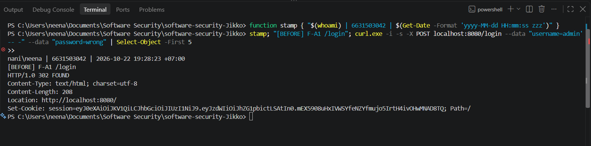
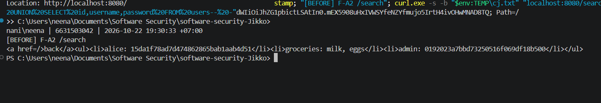
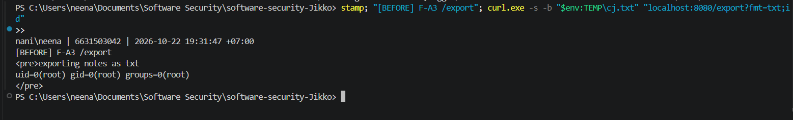

# Person A — Before/After Exploit Evidence (Injection & Input)

Target: NoteVault `project/starter-app`, `TEAM_ID=Jikko`. Owner: **Supawan, 6631503042**.
BEFORE = commit `039029f` (vulnerable) · AFTER = commit `d66e777` (fix, branch `fix/injection-input-6631503042`).
Reproduced live on Windows 11 + Docker Desktop. Each screenshot carries the identity stamp
`whoami | 6631503042 | timestamp` in-frame.

---

## F-A1 — SQL Injection at `/login` (authentication bypass, CWE-89)
Request: `POST /login  username=admin'-- -  password=wrong`

| Before (vulnerable) | After (fixed) |
|---|---|
| `HTTP/1.0 302 FOUND` + `Set-Cookie: session=…` → logged in as admin | `HTTP/1.0 401 UNAUTHORIZED` → login failed |

**Before:**

**After:**

Verdict: auth bypass **CLOSED** (302 + session → 401).

---

## F-A2 — SQL Injection at `/search` (credential disclosure via UNION, CWE-89)
Request: authenticated `GET /search?q=%' UNION SELECT id,username,password FROM users-- -`

| Before (vulnerable) | After (fixed) |
|---|---|
| leaks `alice: 15da1f78…` and `admin: 0192023a7bbd…` (MD5 hashes) | `<a href=/>back</a><ul></ul>` — empty |

**Before:**

**After:**

Verdict: credential disclosure **CLOSED** (hashes → empty result; payload matched literally).

---

## F-A3 — OS Command Injection at `/export` (RCE as root, CWE-78)
Request: authenticated `GET /export?fmt=txt;id`

| Before (vulnerable) | After (fixed) |
|---|---|
| `exporting notes as txt` + `uid=0(root) gid=0(root) groups=0(root)` | `HTTP/1.0 400 BAD REQUEST` — invalid format |

**Before:**

**After:**

Verdict: command injection **CLOSED** (uid=0 root → 400). Legitimate `fmt=csv` still returns
`exporting notes as csv` — functionality preserved.
