# NoteVault Security Review
## Part C: Access Control and Output Handling

| Item | Details |
|---|---|
| Contributor | Bas — Part C |
| Report date | 23 October 2026 |
| Browser evidence added | 30 October 2026 |
| Repository | [ninacodin/software-security-Jikko](https://github.com/ninacodin/software-security-Jikko) |
| Branch | `Bas/access-control-output` |
| Modified file | `project/starter-app/app.py` |
| Baseline commit | `0edc2a3e01c9ac62a6e2c677b65f9a9085b2c45c` |
| Reviewed commit after fixes | `1662fc98cbc33c49c4252719bd5b9ef0c8350346` |

This report covers the findings, fixes, and test results for Part C of the NoteVault project. It provides material for the Vulnerability Findings and Remediation sections of the team report. The code review and automated results describe the Part C changes. The browser evidence added on 30 October 2026 records Bas's later manual checks of the local preview at `http://127.0.0.1:8082/`; it is identified separately from the earlier automated test run.

## 1. Objective and Scope

The review focused on how NoteVault assigns user roles, checks note ownership, returns account information, and displays user input. It also covered the debug settings used when starting the application.

The changes affected `register()`, `seed()`, `api_note()`, `admin()`, `home()`, `search()`, the output of `export()`, and the application startup code. SQL injection, shell command execution, JWT handling, password hashing, and build security remain assigned to the other team members.

## 2. Findings and Fixes

### 2.1 F-C01 — Users Could Choose Their Own Role During Registration

**Location:** `register()` and the `users` table in `seed()`  
**Classification:** CWE-269; CWE-266 describes the incorrect assignment of privileges more specifically.

The original registration function accepted the `role` value from the request and stored it directly. A person registering an account could submit `role=admin`, even though the registration form did not provide a role field.

The database also allowed duplicate usernames. This was a separate access control problem because the application used the username to identify the account in JWTs, role checks, and note ownership. Two accounts with the same username could therefore be treated as the same identity.

The updated function assigns the `user` role on the server and ignores any role supplied by the client. It checks that the username and password are valid, non-empty strings. The table definition now requires unique usernames and prevents null values in the account fields. Duplicate registration returns HTTP 409, while invalid registration data returns HTTP 400.

```diff
- (username, hashlib.md5(password.encode()).hexdigest(), role)
+ (username, hashlib.md5(password.encode()).hexdigest(), "user")

- username TEXT, password TEXT, role TEXT
+ username TEXT NOT NULL UNIQUE, password TEXT NOT NULL, role TEXT NOT NULL
```

**Test result:** Registration requests containing `role=admin`, sent as either form data or JSON, created regular users. These users received HTTP 403 when requesting `/admin`. Duplicate registrations using `alice` or `admin` were rejected. Registration and login with a new username still worked.

#### Browser evidence: duplicate registration (manual test 6)

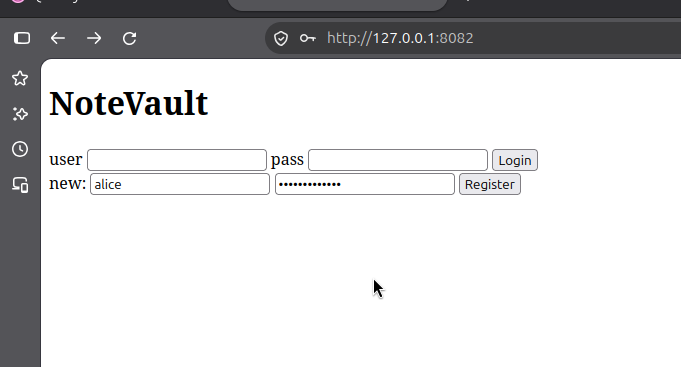

**Figure 1. Attempt to register an existing username.** The registration form contains `alice`, an account already present in the test database. The password is masked. This is the input stage, before the request is submitted.

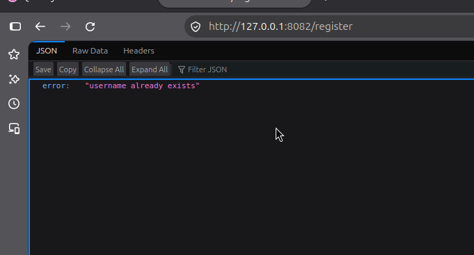

**Figure 2. Duplicate username rejected.** The `/register` response contains `error: "username already exists"`. This supports the duplicate-account check in F-C01. The screenshot does not display an HTTP status code or demonstrate a submitted `role=admin` field; those cases are covered by the automated tests.

**Fix commit:** [`574af26`](https://github.com/ninacodin/software-security-Jikko/commit/574af26)

### 2.2 F-C02 — Note Access Did Not Check Ownership

**Location:** `GET /api/notes/<int:nid>`  
**Classification:** IDOR/BOLA — CWE-639

The original endpoint checked whether the requester was logged in, then selected a note using only its ID. It did not check whether the note belonged to that user. A logged-in user could change the ID in the URL to request another user's note.

The query now checks both the note ID and the owner. The owner value comes from the identity returned by the application's session verification function, rather than a request parameter.

```diff
- SELECT id,owner,title,body FROM notes WHERE id = ?
+ SELECT id,owner,title,body FROM notes WHERE id = ? AND owner = ?
```

**Test result:** Owners could read their own notes with HTTP 200. Requests without a valid session returned HTTP 401. Requests for another user's note and requests for a nonexistent ID both returned HTTP 404 with the same response body. This endpoint follows an owner-only policy, including for administrator accounts.

#### Browser evidence: note ownership (manual test 2)

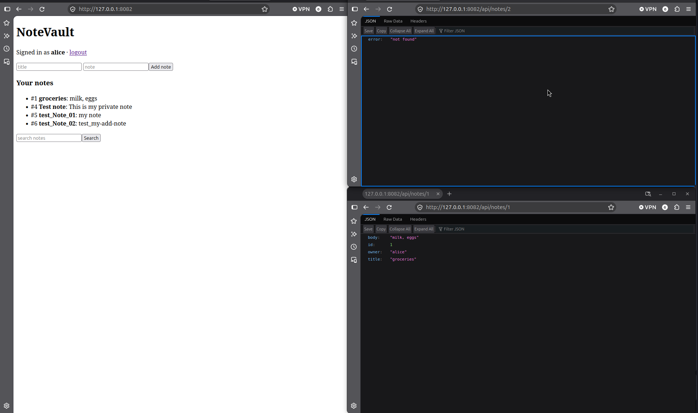

**Figure 3. Own-note access compared with another account's note.** The left window identifies the active account as `alice`. The lower-right window shows `/api/notes/1` returning the note with `owner: "alice"`, while the upper-right window shows `/api/notes/2` returning `error: "not found"`. In the seeded database, note 2 belongs to `admin`. The image therefore records both an allowed request and a rejected cross-owner request. HTTP status codes are not visible in this image.

**Fix commit:** [`2c5df1b`](https://github.com/ninacodin/software-security-Jikko/commit/2c5df1b)

### 2.3 F-C03 — The Admin Endpoint Exposed Password Hashes

**Location:** `GET /admin`  
**Classification:** Sensitive information exposure — CWE-200

The original query selected the `password` column along with the account details and returned it in the JSON response. Although the endpoint required administrator access, password hashes were unnecessary for displaying a user list. Returning them also increased the impact of a compromised administrator account.

The query was changed to select only the fields needed for the user list.

```diff
- SELECT id,username,password,role FROM users
+ SELECT id,username,role FROM users
```

**Test result:** Administrators could still view the user list. Each account object contained only `id`, `username`, and `role`. The response did not contain a `password` field or the seeded password hashes. Regular users and visitors without a session still received HTTP 403.

#### Browser evidence: admin access and response fields (manual test 5)

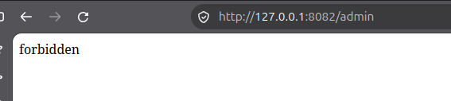

**Figure 4. Rejected request to the admin endpoint.** The browser displays `forbidden` at `/admin`. This is the rejected-access result supplied for the regular-user test. The cropped image does not identify the active account, so the account identity for this request is not independently visible.

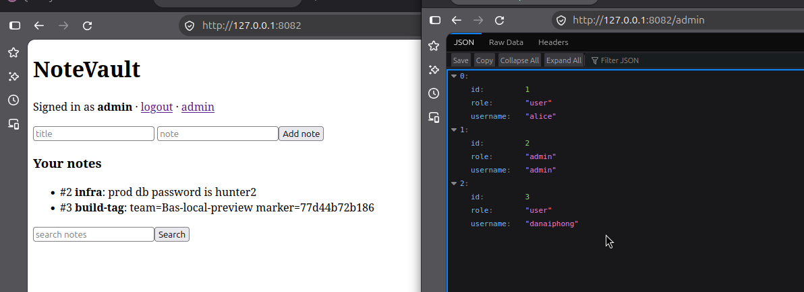

**Figure 5. Administrator access without password hashes in the response.** The left window identifies the account as `admin`. The right window shows the `/admin` JSON entries for `alice`, `admin`, and `danaiphong`, with only `id`, `role`, and `username` fields. No password field is shown. The `infra` note on the left is seeded training content and is separate from the account-list response being tested.

**Fix commit:** [`1e605be`](https://github.com/ninacodin/software-security-Jikko/commit/1e605be)

### 2.4 F-C04 — User Input Was Included Directly in HTML and Templates

**Location:** `PAGE`, `home()`, `search()`, and the output of `export()`  
**Classification:** XSS — CWE-79; template injection — CWE-1336

The home page originally built HTML using note titles and bodies, then displayed it with the `safe` filter. This allowed note content to become HTML markup. The search page had an additional problem: it inserted note content into the template source before Jinja processed it. As a result, text saved in a note could be interpreted as a template expression.

The updated pages use fixed templates and pass note content as data. Jinja loops display the notes, and autoescaping handles the values. The export response also passes its output as a template variable.

```diff
- {{ notes_html|safe }}
+ 
+ <li>#{{ note.id }} <b>{{ note.title }}</b>: {{ note.body }}</li>
+ 

- render_template_string(HTML_FROM_NOTE_VALUES)
+ render_template_string(SEARCH_PAGE, notes=rows)

- return "<pre>%s</pre>" % out.stdout
+ return render_template_string("<pre>{{ output }}</pre>", output=out.stdout)
```

These excerpts show the main changes. The full patch is available in the linked commit.

**Test result:** Note content containing `<script>` and `` tags was escaped in the home and search responses. The text `{{7*7}}` remained unchanged instead of being evaluated as `49`. Export output was also escaped. The export test used mocked subprocess output and did not execute a shell payload.

The tests confirm output encoding and separation of data from template source. The automated tests and browser figures do not establish cross-user XSS or demonstrate successful JavaScript execution. In the normal interface, users view their own notes, so any claim about an effect on another user requires further evidence.

#### Browser evidence: HTML payloads (manual test 3)

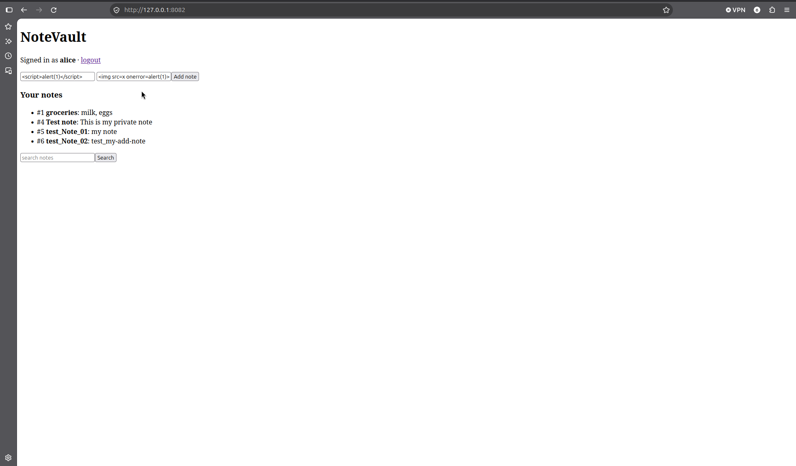

**Figure 6. HTML payload entered into the note form.** While signed in as `alice`, the tester entered `<script>alert(1)</script>` as the title and `` as the body. The image records the input before selecting **Add note**.

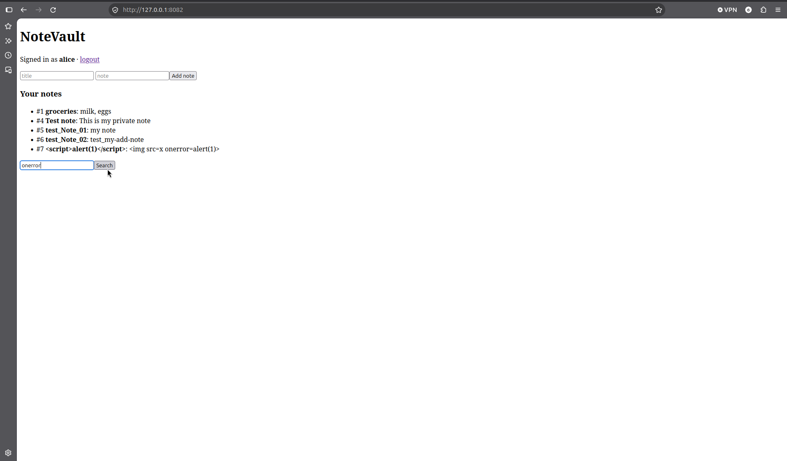

**Figure 7. Stored payload displayed on the home page.** The new note appears as item 7. Its title and body remain readable as literal tag text, rather than appearing as an image element. The search field contains `onerror`, preparing the search check.

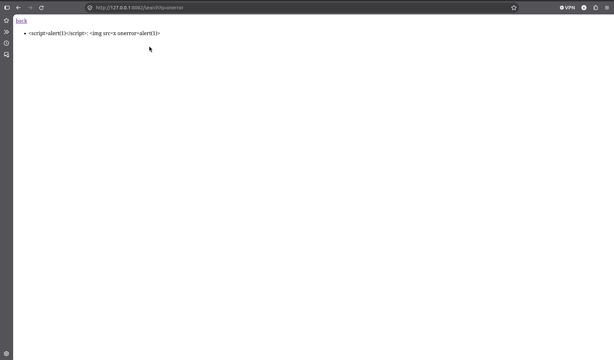

**Figure 8. Payload displayed as text in search results.** The URL contains `/search?q=onerror`, and the result retains both test strings as visible text. Figures 7 and 8 support the output-handling fix in the captured browser states. A static screenshot alone is not a complete record of whether a JavaScript dialog appeared at another time.

#### Browser evidence: template expressions (manual test 4)

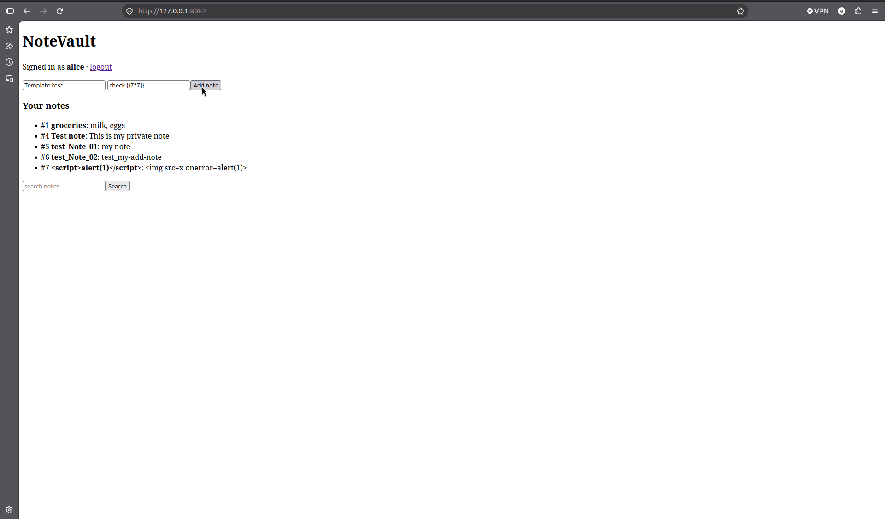

**Figure 9. Template expression entered as note content.** The title is `Template test` and the body is `check {{7*7}}`. This harmless expression checks whether the application treats stored note content as template source.

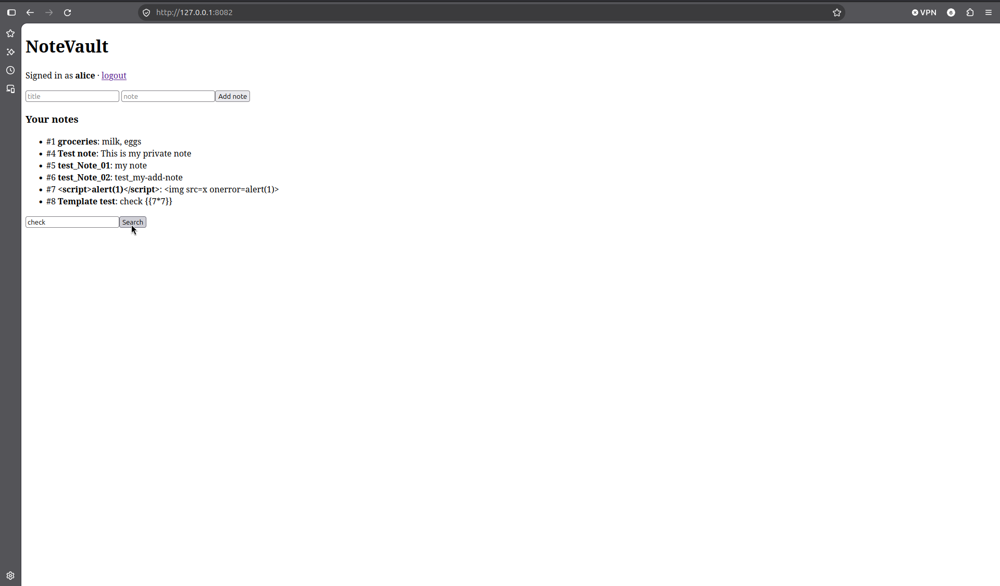

**Figure 10. Expression preserved after saving the note.** Note 8 displays `Template test: check {{7*7}}`. The search field contains `check` for the next step.

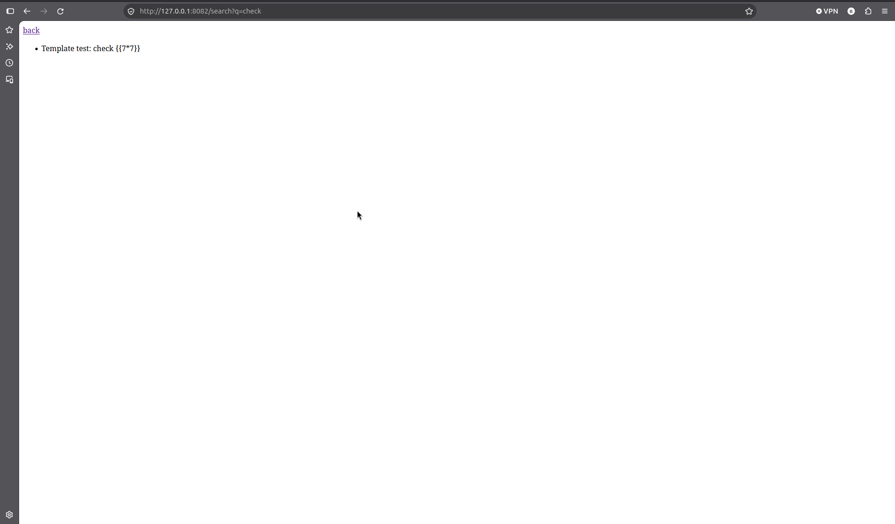

**Figure 11. Search does not evaluate the stored expression.** At `/search?q=check`, the result still reads `Template test: check {{7*7}}`, rather than `check 49`. This directly supports the separation of note data from the search template source.

**Fix commit:** [`80cf57a`](https://github.com/ninacodin/software-security-Jikko/commit/80cf57a)

### 2.5 F-C05 — Debug Mode Was Enabled at Startup

**Location:** The `if __name__ == "__main__"` block  
**Classification:** Active Debug Code — CWE-489

The application originally started with `debug=True`. This setting may expose internal error details and debugger features when the application is run outside a development environment. However, the setting alone does not prove that an attacker can execute commands through the debugger.

The startup call now explicitly disables debug mode, the debugger, and the reloader.

```diff
- app.run(host="0.0.0.0", port=8080, debug=True)
+ app.run(host="0.0.0.0", port=8080, debug=False,
+         use_debugger=False, use_reloader=False)
```

**Test result:** The test confirmed that the startup code passed all three disabling options, including when `FLASK_DEBUG=1` was set. It mocked `Flask.run` to avoid starting a server. This result covers the modified entry point. Starting the application through Flask CLI or a separate deployment configuration requires its own checks.

**Fix commit:** [`af24b72`](https://github.com/ninacodin/software-security-Jikko/commit/af24b72)

## 3. Test Method and Results

The recorded tests used Python 3.12.15 with Flask 2.0.1, Werkzeug 2.0.1, Jinja2 3.0.1, and PyJWT 1.7.1. Flask's test client handled the requests. Each test used a temporary database, keeping the test data separate from the database used for manual browsing.

The following command runs the tests in the environment prepared on this machine:

```bash
PYTHONDONTWRITEBYTECODE=1 .venv/py312/bin/python -m unittest discover -s project/tests -p 'test_person_c.py' -v
```

| Test group | Test methods | Result after fixes |
|---|---:|---|
| Registration, role assignment, duplicate usernames, and invalid input | 7 | Passed |
| Note access and ownership | 4 | Passed |
| Admin access and response fields | 2 | Passed |
| Note rendering and export output | 3 | Passed |
| Debug settings at the entry point | 1 | Passed |
| **Total** | **17** | **All passed** |

The saved [test log](test-results.txt) records 17 passing tests with exit code 0 for the fixed code. The same suite was run against the baseline source from `main` in a temporary directory. That run reported `failures=18, errors=13`. These counts include subtests and should not be interpreted as separate vulnerabilities or separate test methods.

The suite checks normal use as well as rejected requests. This helps confirm that users can still register and log in, owners can read their notes, and administrators can view the user list after the fixes.

### 3.1 Browser Check of Normal Use (Manual Test 1)

The supplied screenshots document normal use alongside the security checks. The following two images show the initial session and a new note being prepared.

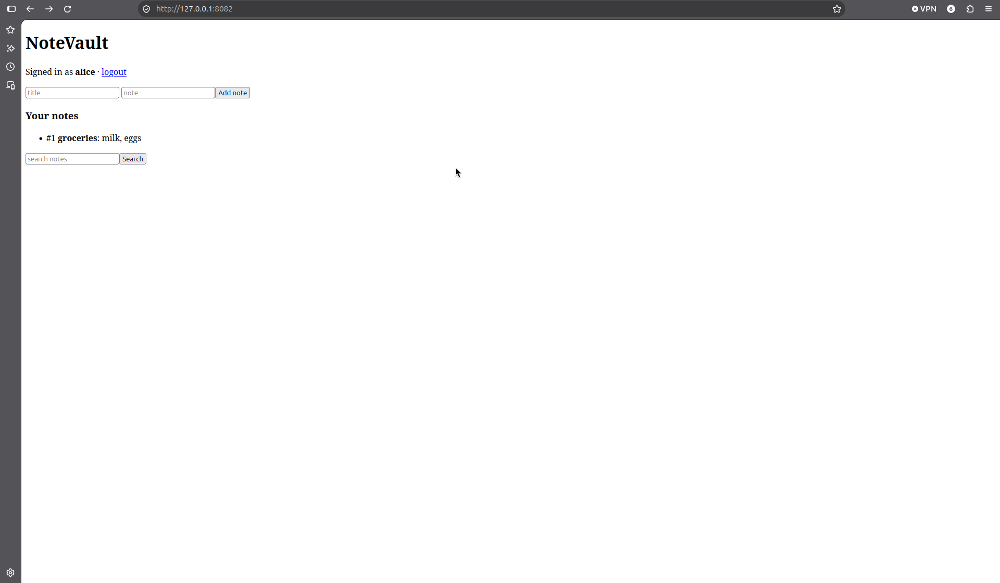

**Figure 12. Normal login and note list.** The page shows `Signed in as alice`, the seeded `groceries` note, and the note and search forms. This records that the basic interface is available after login.

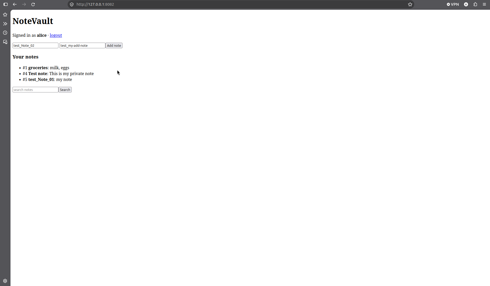

**Figure 13. Preparing another note.** The title field contains `test_Note_02` and the body contains `test_my-add-note`. Existing notes, including `Test note: This is my private note`, remain visible. This image captures input rather than submission; Figure 3 shows `test_Note_02` as note 6 in the subsequent browser state, supporting that the new note was saved.

### 3.2 Evidence Scope

The image sequence corresponds to manual tests 1–6. These numbers describe the browser walkthrough, not findings F-C01–F-C05. The screenshots provide after-fix evidence for normal use, ownership checks, HTML rendering, template handling, admin output, and duplicate registration. They do not provide before-fix screenshots, a browser request containing `role=admin`, or evidence of the debug startup settings. The earlier automated results remain the evidence for those unpictured checks.

The admin image identifies the environment as `Bas-local-preview`; this is a local preview marker, not a verified team submission marker. The screenshots also do not show the course-required terminal stamp with student ID and timestamp. Their original contents have been retained without adding an identity or time label. Stamped evidence should be captured separately before final submission. The exact source commit cannot be established from the screenshots alone.

## 4. Limitations and Integration

The unique username constraint was added to the schema in `seed()`, so it applies to newly created databases. An existing database needs a migration and a check for duplicate accounts. Updating the source code alone does not change its schema.

When merging Part A, the team must retain both the SQL fixes and the updated rendering in `search()`. The command execution fix and output escaping in `export()` must also be kept together. When merging Part B, the updated password hashing must preserve server-side role assignment and unique usernames.

The recorded unit tests do not provide evidence of a Docker build. The browser figures document only the manual cases shown and do not replace a complete browser test. Final submission evidence still requires the tester's identity and timestamp as specified by the course. Application tests and build checks should be repeated after all branches are merged.

## 5. Discussion

The changes address three related issues: who can receive a privilege, who can access a particular note, and what information the application returns. Fixed templates also prevent note content from becoming part of the template source.

The duplicate username issue shows why changing a single role field was not enough. Since several parts of the application identify users by username, that value must distinguish one account from another. The database constraint supports the access checks made by the application.

The test results support the fixes within Part C's scope. A final assessment of NoteVault still depends on the combined code, especially the SQL injection, command execution, and session handling changes that affect the trustworthiness of a requester's identity.

## 6. References and Evidence

- [Course report template](../../REPORT-TEMPLATE.md)
- [Detailed Part C remediation notes](remediation.md)
- [Part C regression tests](../../tests/test_person_c.py)
- [Recorded baseline and fixed-code test results](test-results.txt)
- [MITRE CWE-266: Incorrect Privilege Assignment](https://cwe.mitre.org/data/definitions/266.html)
- [MITRE CWE-639: Authorization Bypass Through User-Controlled Key](https://cwe.mitre.org/data/definitions/639.html)
- [MITRE CWE-200: Exposure of Sensitive Information](https://cwe.mitre.org/data/definitions/200.html)
- [MITRE CWE-79: Cross-site Scripting](https://cwe.mitre.org/data/definitions/79.html)
- [MITRE CWE-1336: Improper Neutralization of Special Elements Used in a Template Engine](https://cwe.mitre.org/data/definitions/1336.html)
- [MITRE CWE-489: Active Debug Code](https://cwe.mitre.org/data/definitions/489.html)
