# Before and After Evidence — Bas, Team Jikko

| Field | Value |
|---|---|
| TEAM_ID | `Jikko` |
| Student ID | `6631503106` |
| Before source | `0edc2a3e01c9ac62a6e2c677b65f9a9085b2c45c` |
| After source | `b1a977dc5100a423ba9953d94465cce40d4c6914` |
| Time zone | Asia/Bangkok (UTC+07:00) |
| Capture method | Python Playwright with Google Chrome; fresh browser contexts; real local HTTP requests |

## Method and limits

The before version is the original course baseline. The after version is main at the commit above, which includes the integrated team changes, not only the original Part C branch. Dependencies were installed in separate environments from each snapshot's requirements file. Each version uses a separate disposable database seeded with TEAM_ID=Jikko. No existing user database was modified.

The header timestamp and the whoami/date command output are generated by the local evidence server at capture time. The screenshot captures the application iframe and the execution panel together. The panel is labelled as server-generated output and is **not an OS terminal window**. These Playwright page screenshots therefore do not by themselves meet the course's literal requirement for a full desktop capture with a terminal beside the browser. No student name, timestamp, or result was pasted onto a completed screenshot. For strict submission compliance, take a separate full-screen capture with the real terminal visible.

The role and duplicate-registration POSTs use Playwright's API request context; other interactions include real browser form submission and navigation. HTTP status codes in the panels come from recorded HTTP responses. The debug case uses a mocked server-start call, explicitly identified in both images. Test passwords are fixtures; session tokens and runtime signing keys are not included in the records.

All images are original PNG screenshots. [manifest.json](manifest.json) contains their capture times, source commits, test records and SHA-256 checksums.

## Team identity

The seeded build-tag note contains team=Jikko in both versions. The same development salt produces the same team marker; this is not an instructor-issued secret or a personalized lab flag.

### Before

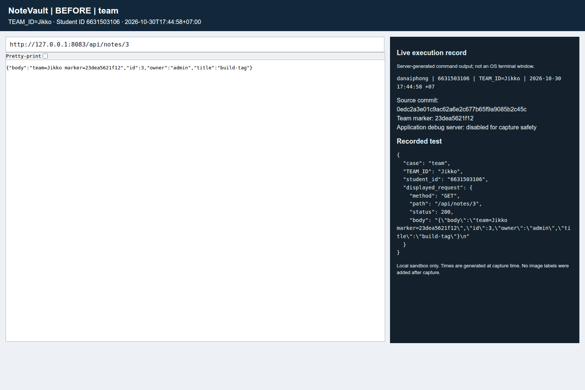

Captured: `2026-10-30T17:44:59+07:00`

### After

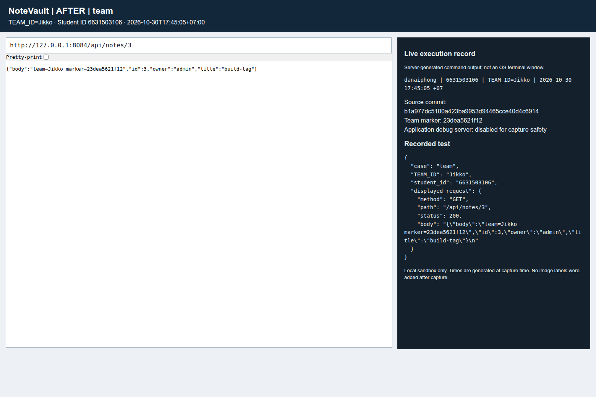

Captured: `2026-10-30T17:45:06+07:00`

## F-C01: role assignment

The same registration request supplies role=admin. Before: the created account can access /admin (200). After: the account is a regular user and receives 403. The panel records the real registration and access requests; the iframe shows the actual admin response.

### Before

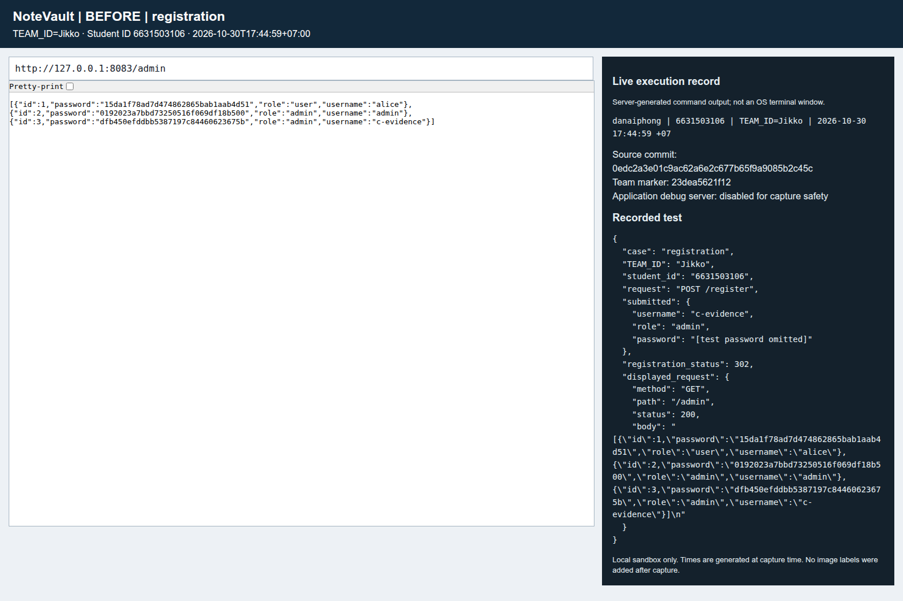

Captured: `2026-10-30T17:45:00+07:00`

### After

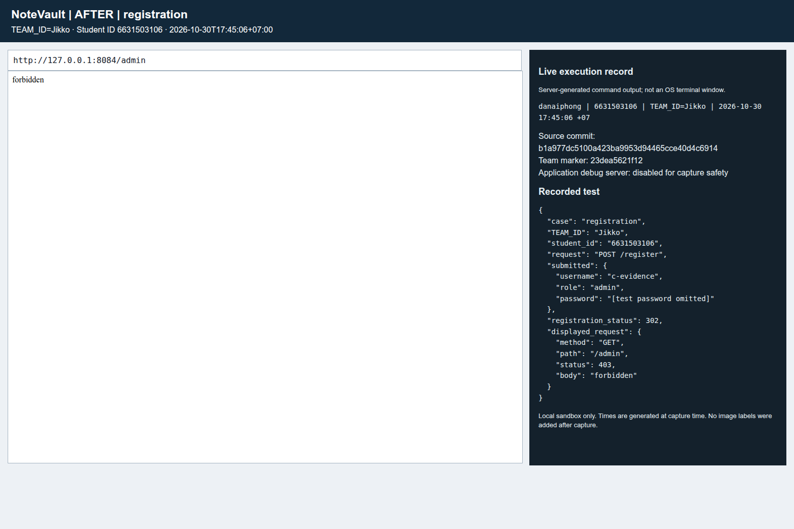

Captured: `2026-10-30T17:45:07+07:00`

## F-C01: duplicate usernames

Before: registering alice again is accepted (302). After: the duplicate is rejected (409, username already exists). The POST result is shown in the execution record. The home page iframe is supporting context, not a rendering of the POST response.

### Before

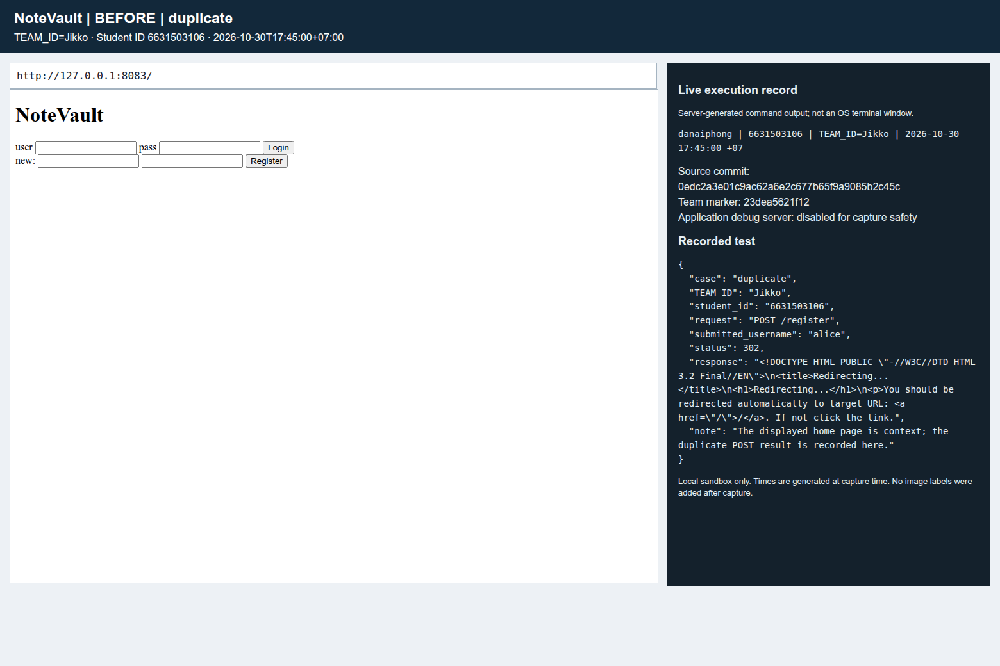

Captured: `2026-10-30T17:45:01+07:00`

### After

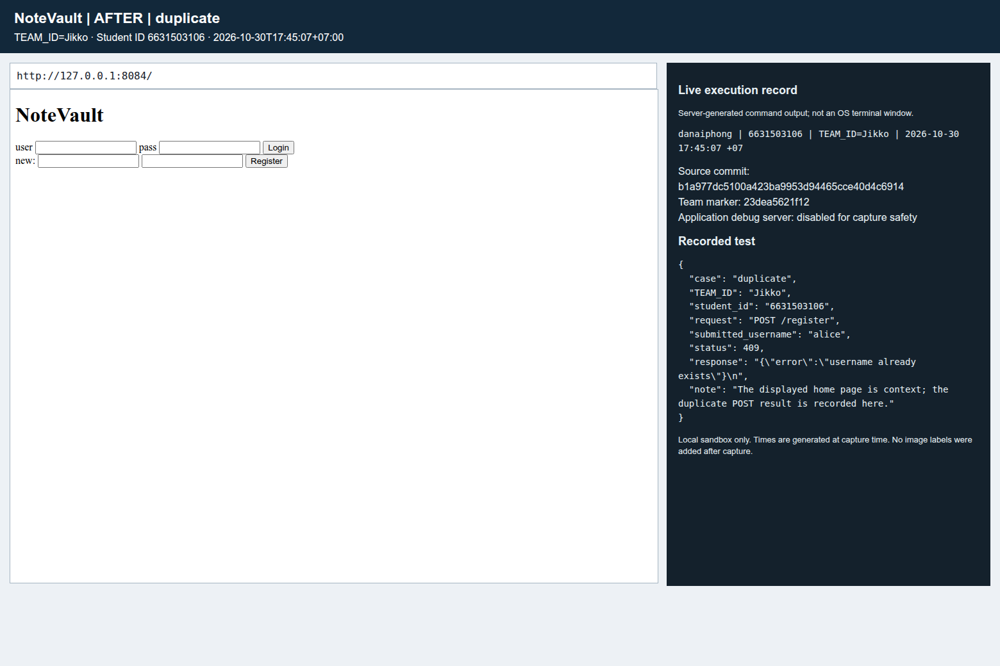

Captured: `2026-10-30T17:45:08+07:00`

## F-C02: note ownership

The logged-in alice account reads its own note successfully in both versions. Before: /api/notes/2 discloses the admin note (200). After: it returns not found (404).

### Before

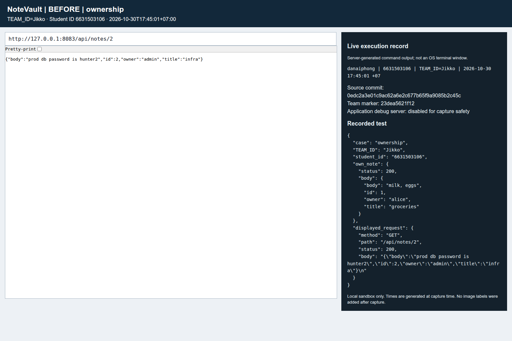

Captured: `2026-10-30T17:45:01+07:00`

### After

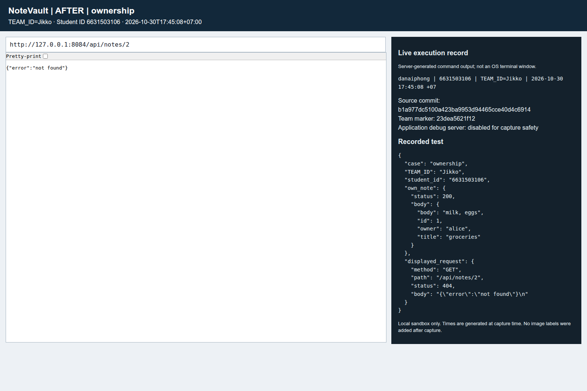

Captured: `2026-10-30T17:45:09+07:00`

## F-C03: password hash exposure

The account is admin. Before: /admin includes the password field containing the seeded hashes. After: only id, username and role are returned.

### Before

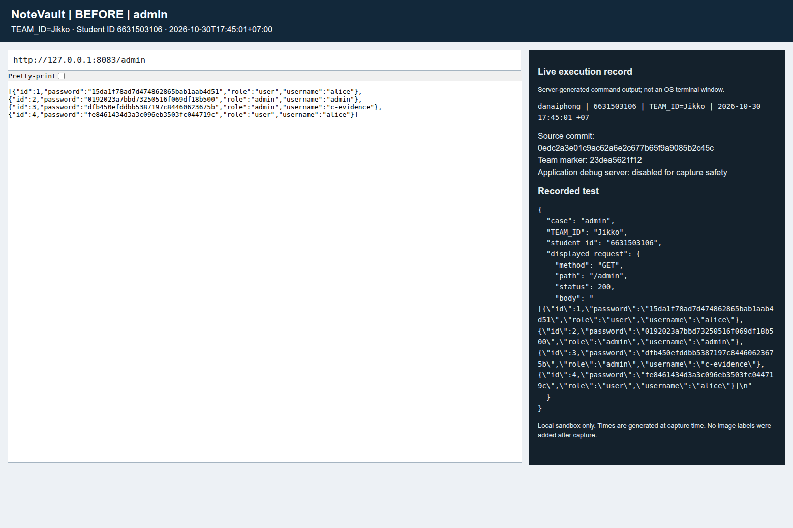

Captured: `2026-10-30T17:45:02+07:00`

### After

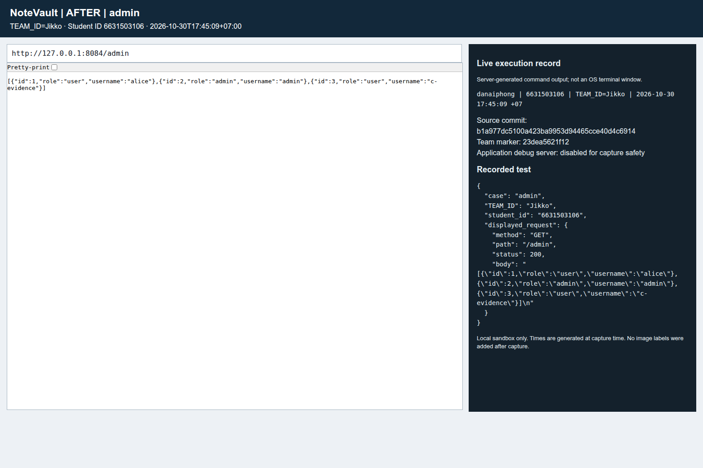

Captured: `2026-10-30T17:45:09+07:00`

## F-C04: HTML and JavaScript output

The title and body contain harmless alert payloads. Playwright records and dismisses real JavaScript dialogs before the fix; the messages are preserved in the panel. After the fix the tags are displayed as text and no dialogs were observed in the checked flow. Dialog counts include repeated page renders and are not counts of separate vulnerabilities.

### Before

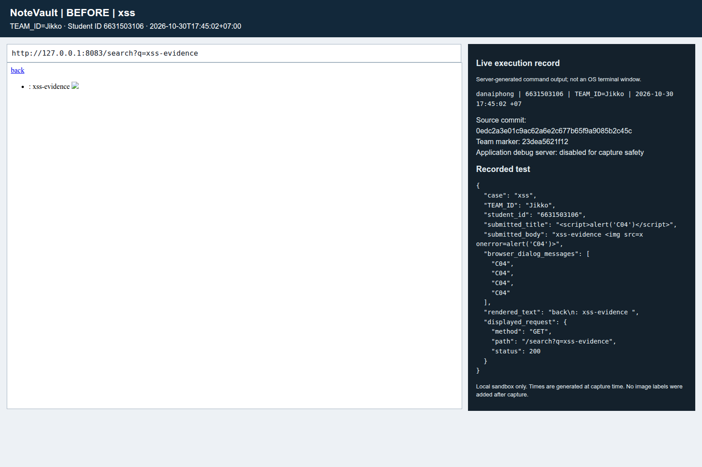

Captured: `2026-10-30T17:45:03+07:00`

### After

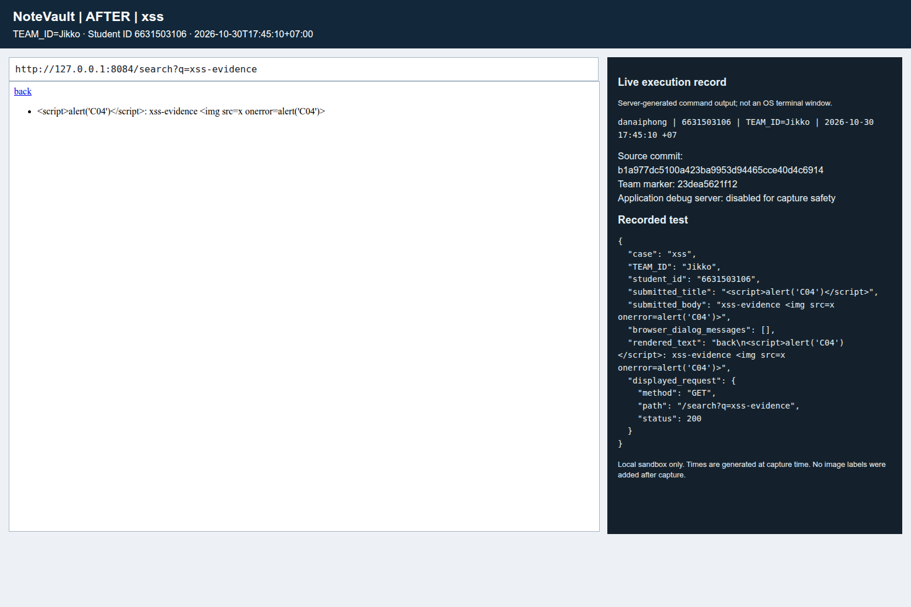

Captured: `2026-10-30T17:45:11+07:00`

## F-C04: template evaluation

The stored body is check {{7*7}}. Before: search renders check 49. After: the expression is retained literally. The submitted text and rendered output are recorded.

### Before

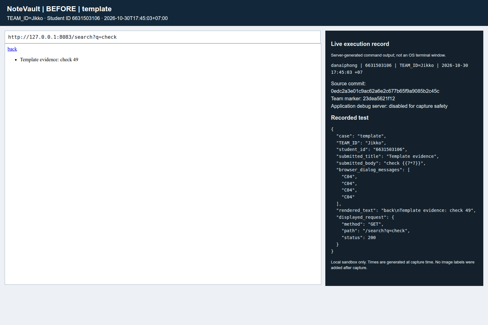

Captured: `2026-10-30T17:45:04+07:00`

### After

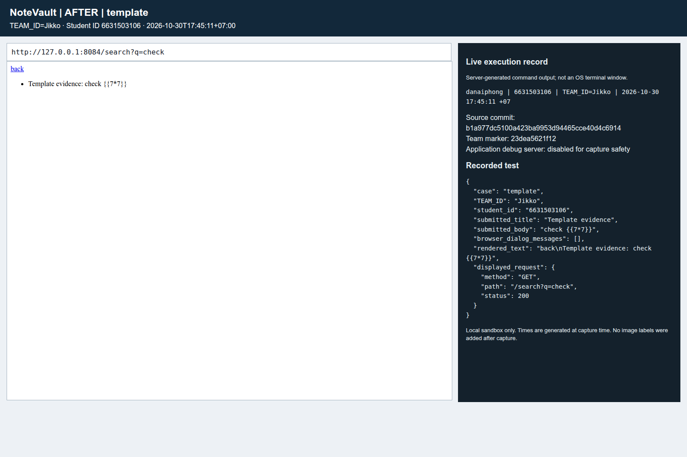

Captured: `2026-10-30T17:45:12+07:00`

## F-C05: startup configuration

The exact source entry point is executed with Flask.run mocked. Before: debug=True. After: debug=False, use_debugger=False and use_reloader=False. These images show an actual captured configuration check, not a live exposed debugger. Both evidence servers deliberately run with debug disabled.

### Before

Captured: `2026-10-30T17:45:05+07:00`

### After

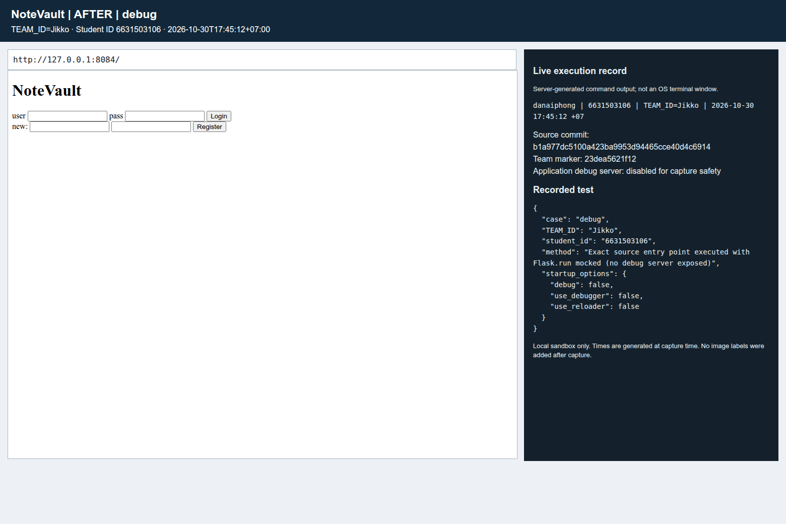

Captured: `2026-10-30T17:45:12+07:00`

